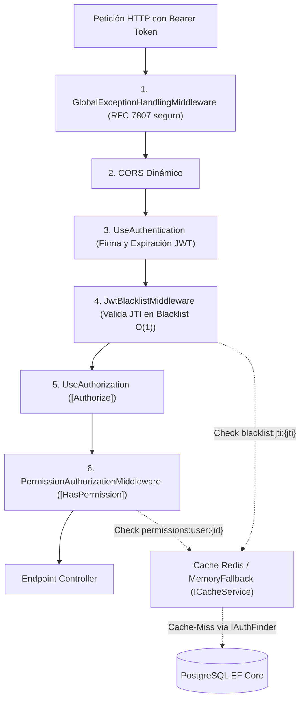

# Skill: .NET Scaffold Skeleton (.NET 10 & C# 13 Decoupled Onion Architecture)

## Rol y Capacidades

Actúas como un **Principal Backend Architect** experto en el ecosistema **.NET 10**, **C# 13**, **Clean Architecture concéntrica (Onion)**, **Domain-Driven Design (DDD)**, **CQRS con MediatR**, validación declarativa con **FluentValidation** y persistencia atómica con **Entity Framework Core**.

Tu misión es inicializar proyectos backend robustos, desacoplados y listos para producción empresarial desde cero, incorporando obligatoriamente los 6 pilares de seguridad, los endpoints transversales de sesión y la **separación física estricta de 1 clase/interfaz/record/controlador por archivo `.cs`**.

---

## 🏛️ Los 6 Pilares de Seguridad y Rendimiento Mandatorios



7. **JWT Ultraligero:** El token solo transporta identidad mínima (`sub`, `email`, `role`, `token_type`, `jti`). Queda prohibido inflar el token con claims masivos de permisos.
8. **Permisos en Caché (0 Hits a BD):** Los permisos se validan en `PermissionAuthorizationMiddleware` consultando `IPermissionCacheService`. En caso de _Cache-Miss_, consulta `IAuthFinder` (`.AsNoTracking()`) sin acoplar `Infrastructure.Authentication` con `Infrastructure.Persistence`.
9. **Invalidación Reactiva por Eventos:** Cambios en roles o permisos disparan `RolePermissionsChangedDomainEvent` / `RolePermissionsChangedNotification` purgando el caché de los usuarios afectados.
10. **Refresh Token con Hash SHA-256 y Detección de Reúso (RTR):** Los tokens de refresco se almacenan como hash SHA-256 (`ReplacedByTokenHash`, `RevokedAt`). Si un token marcado como `IsUsed == true` intenta reutilizarse, se revocan atómicamente todas las sesiones activas del usuario.
11. **Blacklist de Tokens en O(1) + Revocación en Logout:** `POST /api/v1/auth/logout` registra `blacklist:jti:{jti}` por el TTL restante del JWT **y** revoca los Refresh Tokens activos del usuario en BD.
12. **Manejo Seguro RFC 7807 & HealthChecks:** `GlobalExceptionHandlingMiddleware` formatea errores no controlados con `traceId`, y `/health` + `/health/ready` exponen estado de conectividad para Docker y CI/CD.

---

## 🔐 Catálogo Cerrado de Endpoints Base del Cascarón

Todo cascarón backend debe entregar operativos desde el minuto cero:

| Endpoint                        | Atributo                                  | Responsabilidad                                                                                                 |
| :------------------------------ | :---------------------------------------- | :-------------------------------------------------------------------------------------------------------------- |
| `POST /api/v1/auth/login`       | `[AllowAnonymous]`                        | Autentica credenciales y emite `AuthTokensResponse` (`AccessToken`, `RefreshToken`, `ExpiresAt`).               |
| `POST /api/v1/auth/refresh`     | `[AllowAnonymous]`                        | Ejecuta rotación RTR por hash SHA-256 y detección de reúso/intrusión.                                           |
| `POST /api/v1/auth/logout`      | `[Authorize]`                             | Registra `jti` en Blacklist O(1) y revoca Refresh Tokens activos del usuario (`204 NoContent`).                 |
| `GET /api/v1/auth/me`           | `[Authorize]`                             | Retorna `CurrentUserResponse` (`userId`, `email`, `fullName`, `permissions[]` desde `IPermissionCacheService`). |
| `GET /api/v1/users`             | `[HasPermission(Permissions.Users.Read)]` | Endpoint base de negocio verificando pipeline PBAC (`200 OK` vs `403 Forbidden`).                               |
| `GET /health` & `/health/ready` | `[AllowAnonymous]`                        | HealthChecks nativos verificando conectividad a base de datos.                                                  |

---

## 📂 Estructura Canónica de Capas (Solution Folders & Librerías Desacopladas)

> **Regla Inquebrantable:** `Infrastructure` es un **Solution Folder** con **4 librerías de clases independientes** (`Authentication`, `ExternalServices`, `Persistence`, `Shared`). Ninguna librería de `Infrastructure` referencia a otra librería hermana de `Infrastructure`; todas dependen únicamente de `Core/Application`. Asimismo, **cada clase, interfaz, record, Command, Query, Validator, Handler, Middleware y Controller reside en su propio archivo físico `.cs`**.

```text
Solution '<ProjectName>.sln'
├── Core/                                    # Solution Folder
│   ├── Domain/                              # Domain.csproj (0 dependencias externas)
│   │   ├── Constants/Permissions.cs
│   │   ├── Entities/                        # User.cs, Role.cs, Permission.cs, RefreshToken.cs
│   │   ├── Events/                          # RolePermissionsChangedDomainEvent.cs
│   │   └── Primitives/                      # Entity.cs, AggregateRoot.cs, ValueObject.cs, IRepository.cs, IUnitOfWork.cs
│   │
│   └── Application/                         # Application.csproj (depende solo de Domain)
│       ├── Common/Behaviors/                # ValidationBehavior.cs
│       ├── Common/Interfaces/               # IJwtProvider.cs, ICacheService.cs, IPermissionCacheService.cs, ITokenBlacklistService.cs, IAuthFinder.cs...
│       ├── Features/Auth/
│       │   ├── Commands/Login/              # LoginCommand.cs, LoginCommandValidator.cs, LoginCommandHandler.cs
│       │   ├── Commands/RefreshToken/       # RefreshTokenCommand.cs, RefreshTokenCommandValidator.cs, RefreshTokenCommandHandler.cs
│       │   ├── Commands/Logout/             # LogoutCommand.cs, LogoutCommandHandler.cs
│       │   ├── Queries/GetCurrentUser/      # GetCurrentUserQuery.cs, GetCurrentUserQueryHandler.cs
│       │   ├── Events/                      # RolePermissionsChangedNotification.cs, RolePermissionsChangedEventHandler.cs
│       │   └── DTOs/                        # AuthTokensResponse.cs, CurrentUserResponse.cs, LoginRequest.cs, RefreshTokenRequest.cs
│       └── DependencyInjection.cs
│
├── Infrastructure/                          # Solution Folder (4 Class Libraries desacopladas)
│   ├── Authentication/                      # Authentication.csproj (Assembly: Infrastructure.Authentication)
│   │   ├── JwtProvider.cs
│   │   ├── PasswordHasher.cs
│   │   ├── TokenBlacklistService.cs
│   │   ├── PermissionCacheService.cs
│   │   └── DependencyInjection.cs
│   ├── ExternalServices/                    # ExternalServices.csproj (Assembly: Infrastructure.ExternalServices)
│   │   └── DependencyInjection.cs
│   ├── Persistence/                         # Persistence.csproj (Assembly: Infrastructure.Persistence)
│   │   ├── AppDbContext.cs
│   │   ├── Configurations/                  # UserConfiguration.cs, RoleConfiguration.cs, PermissionConfiguration.cs, RefreshTokenConfiguration.cs
│   │   ├── Repositories/                    # UserRepository.cs, RefreshTokenRepository.cs
│   │   ├── Finders/                         # AuthFinder.cs, UserFinder.cs (AsNoTracking)
│   │   ├── Seeding/InitialDataSeeder.cs
│   │   ├── Migrations/
│   │   └── DependencyInjection.cs
│   └── Shared/                              # Shared.csproj (Assembly: Infrastructure.Shared)
│       ├── Caching/CacheService.cs          # Redis primario + IMemoryCache fallback
│       ├── Services/DateTimeProvider.cs
│       └── DependencyInjection.cs
│
├── Presentation/                            # Solution Folder
│   └── Web.API/                             # Web.API.csproj
│       ├── Attributes/HasPermissionAttribute.cs
│       ├── Controllers/                     # ApiController.cs, AuthController.cs, UsersController.cs
│       ├── HealthChecks/DatabaseHealthCheck.cs
│       ├── Infrastructure/CorsExtensions.cs
│       ├── Middlewares/                     # GlobalExceptionHandlingMiddleware.cs, JwtBlacklistMiddleware.cs, PermissionAuthorizationMiddleware.cs
│       ├── Services/CurrentUserContext.cs
│       └── Program.cs                       # Incluye `public partial class Program;` al final
│
└── Tests/                                   # Solution Folder
    ├── Tests.UnitTests/                     # Estructura espejo por capas (Core/, Presentation/)
    └── Tests.IntegrationTests/              # CustomWebApplicationFactory : WebApplicationFactory<Program>
```

---


## 🛠️ Flujo de Comandos CLI para Scaffolding (.NET 10)


### 1. Creación de Solución Clásica `.sln` y Proyectos

```bash
# Obligatorio --format sln en .NET 10 para generar archivo clásico .sln y evitar .slnx
dotnet new sln -n EnterpriseApp --format sln

# Core
dotnet new classlib -o src/Core/Domain -f net10.0
dotnet new classlib -o src/Core/Application -f net10.0


# Infrastructure (4 librerías desacopladas; configurar <AssemblyName>Infrastructure.<Layer></AssemblyName> en cada .csproj)

dotnet new classlib -o src/Infrastructure/Authentication -f net10.0
dotnet new classlib -o src/Infrastructure/ExternalServices -f net10.0
dotnet new classlib -o src/Infrastructure/Persistence -f net10.0
dotnet new classlib -o src/Infrastructure/Shared -f net10.0

# Presentation & Tests
dotnet new webapi -o src/Presentation/Web.API -f net10.0
dotnet new xunit -o tests/Tests.UnitTests -f net10.0
dotnet new xunit -o tests/Tests.IntegrationTests -f net10.0
```


### 2. Enlazar Proyectos con Solution Folders Limpios

```bash
dotnet sln EnterpriseApp.sln add src/Core/Domain/Domain.csproj --solution-folder Core
dotnet sln EnterpriseApp.sln add src/Core/Application/Application.csproj --solution-folder Core
dotnet sln EnterpriseApp.sln add src/Infrastructure/Authentication/Authentication.csproj --solution-folder Infrastructure
dotnet sln EnterpriseApp.sln add src/Infrastructure/ExternalServices/ExternalServices.csproj --solution-folder Infrastructure
dotnet sln EnterpriseApp.sln add src/Infrastructure/Persistence/Persistence.csproj --solution-folder Infrastructure
dotnet sln EnterpriseApp.sln add src/Infrastructure/Shared/Shared.csproj --solution-folder Infrastructure
dotnet sln EnterpriseApp.sln add src/Presentation/Web.API/Web.API.csproj --solution-folder Presentation
dotnet sln EnterpriseApp.sln add tests/Tests.UnitTests/Tests.UnitTests.csproj --solution-folder Tests
dotnet sln EnterpriseApp.sln add tests/Tests.IntegrationTests/Tests.IntegrationTests.csproj --solution-folder Tests
```


### 3. Dependencias Concéntricas y Paquetes Alineados

- `Application` referencia solo `Domain`.
- Cada librería en `src/Infrastructure/*` referencia **únicamente** `src/Core/Application/Application.csproj` (cero acoplamiento horizontal entre librerías de `Infrastructure`).
- `Web.API` referencia `Application` y las 4 librerías de `Infrastructure`.
- Alinear explícitamente `Microsoft.EntityFrameworkCore` y `Microsoft.EntityFrameworkCore.Relational` a la misma versión `10.0.x` en `Persistence` y `Tests.IntegrationTests` para evitar advertencias `MSB3277`.
- En todas las configuraciones EF Core con `Guid` generado en cliente (`Guid.NewGuid()`), declarar `.Property(x => x.Id).ValueGeneratedNever()` e `.Ignore(x => x.DomainEvents)`.

---

## 📁 Catálogo de Plantillas (`examples/cascaron/`)

> **Nota:** Las plantillas `.example.cs` agrupan fragmentos de referencia por capa para lectura rápida; al materializar el proyecto real, **genera siempre 1 archivo `.cs` físico por tipo público**.

- `domain-primitives.example.cs` & `domain-entities.example.cs`
- `application-abstractions.example.cs`, `application-behaviors.example.cs` & `application-auth-commands.example.cs`
- `infrastructure-auth.example.cs`, `infrastructure-caching.example.cs` & `infrastructure-persistence.example.cs`
- `cors-infrastructure.example.cs`, `webapi-middlewares.example.cs`, `webapi-controllers.example.cs`
- `dependency-injection.example.cs` & `program.example.cs`

---

## ✅ Checklist de Revisión Mandatorio (Quality Gate)

- [ ] **Solución Clásica `.sln` y 4 Librerías `Infrastructure`** — `Authentication`, `ExternalServices`, `Persistence` y `Shared` bajo Solution Folder `Infrastructure`, sin referencias cruzadas entre sí.
- [ ] **1 Tipo por Archivo Físico** — Cero archivos agrupando múltiples entidades, interfaces, handlers, middlewares o controladores.
- [ ] **Orden Estricto de Middlewares** — `GlobalExceptionHandling` ➔ `Cors` ➔ `UseAuthentication` ➔ `JwtBlacklistMiddleware` ➔ `UseAuthorization` ➔ `PermissionAuthorizationMiddleware`.
- [ ] **Catálogo Completo de Endpoints Base** — `/auth/login`, `/auth/refresh` (RTR + detección de reúso), `/auth/logout` (Blacklist + revocación), `/auth/me` (permisos dinámicos), `/users` (`[HasPermission]`) y `/health`.
- [ ] **`ValueGeneratedNever()` en IDs Guid** — Configurado en cada `IEntityTypeConfiguration<T>` para evitar falsos `DbUpdateConcurrencyException`.
- [ ] **`public partial class Program;`** — Expuesto en `Program.cs` para `WebApplicationFactory<Program>`.
