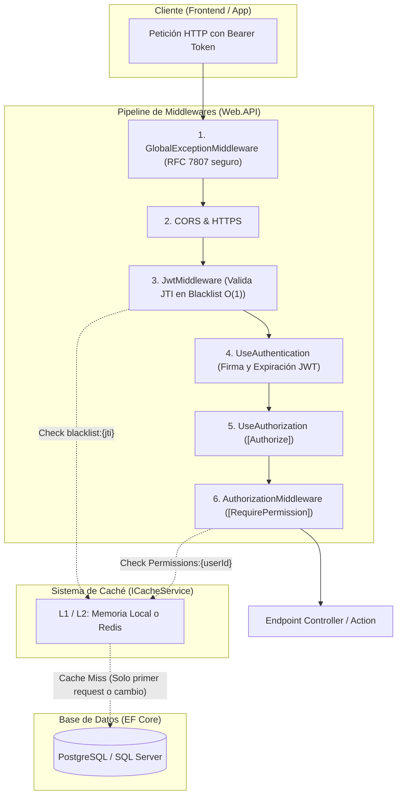

# 🛡️ BLUEPRINT DE SEGURIDAD Y RENDIMIENTO: CASARÓN BASE BACKEND (.NET)
> **Documento de especificación técnica y patrones de código para la Skill `be-dotnet-scaffold`**  
> **Target Framework:** .NET 8 / .NET 9 / .NET 10  
> **Estilo Arquitectónico:** Clean Architecture + Domain-Driven Design (DDD) + CQRS con MediatR + Result Pattern (`ErrorOr`)

---

## 📌 INSTRUCCIÓN PARA EL AGENTE DE SCAFFOLDING
> *Usa esta especificación como el **Núcleo de Seguridad, Autenticación, RBAC y Caché** del cascarón backend. Integra estos componentes de manera estricta dentro de las capas correspondientes (`Domain`, `Application`, `Infrastructure`, `Web.API`), complementándolos con el resto del andamiaje que requiera el proyecto (Auditoría, EF Core, FluentValidation, Swagger, Logging).*

---

## 🏛️ LOS 6 PILARES ARQUITECTÓNICOS



### Resumen de Decisiones de Diseño:
1. **JWT Ultraligero (Sin sobrecarga de red):** El JWT **no** contiene la lista de 30–50 permisos. Solo transporta identidad básica (`sub`, `name`, `role`, `company_id`, `token_type`, `jti`).
2. **Permisos en Caché (0 Hits a la BD en peticiones habituales):** Los permisos se validan en el servidor usando `ICacheService` (`Permissions:{userId}`). Se cargan en el primer request y se conservan en memoria/Redis.
3. **Invalidación Reactiva por Eventos:** Cuando un admin cambia permisos o roles, se dispara `RolePermissionsChangedDomainEvent` que purga inmediatamente la clave del caché. Cero latencia y cero permisos obsoletos.
4. **Refresh Token Seguro con Rotación (RTR):** El Refresh Token se almacena en la tabla `RefreshTokens` cifrado con **hash SHA-256** (nunca en texto plano). Al renovarse, se rota; si se detecta un token ya usado, se activa la **detección de intrusión** y se revocan todas las sesiones activas del usuario.
5. **Blacklist por `jti` en Microsegundos:** En el Logout solo se almacena `blacklist:{jti}` con TTL igual a la vida remanente del token.
6. **Manejo Seguro de Errores (RFC 7807):** Nunca se expone el stack trace (`e.ToString()`) en respuestas públicas. Se devuelven `ProblemDetails` con un `TraceId` correlacionado a logs internos.

---

## 📂 ESTRUCTURA DE ARCHIVOS A GENERAR

```text
Core/
├── Domain/
│   ├── Entities/
│   │   ├── Users/ (User.cs, UserId.cs)
│   │   ├── Roles/ (Role.cs, RoleId.cs)
│   │   ├── Permissions/ (Permission.cs, PermissionId.cs)
│   │   ├── RolePermissions/ (RolePermission.cs)
│   │   └── Auth/ (RefreshToken.cs, RefreshTokenId.cs)
│   ├── Enums/ (PermissionType.cs, RoleType.cs, TokenType.cs)
│   └── Events/ (RolePermissionsChangedDomainEvent.cs)
│
├── Application/
│   ├── Abstractions/
│   │   ├── Caching/ (ICacheService.cs, IPermissionCacheService.cs)
│   │   ├── Authentication/ (IJwtProvider.cs, ITokenBlacklistService.cs)
│   │   └── Services/ (ICurrentUserService.cs)
│   ├── Attributes/ (RequirePermissionAttribute.cs)
│   └── Features/Auth/
│       ├── Commands/Login/
│       ├── Commands/RefreshToken/
│       ├── Commands/LogOut/
│       └── Events/RolePermissionsChangedEventHandler.cs
│
Infrastructure/
├── Authentication/
│   ├── JwtOptions.cs
│   ├── JwtProvider.cs
│   └── Services/ (CurrentUserService.cs, TokenBlacklistService.cs)
├── Caching/
│   ├── MemoryCacheService.cs
│   └── PermissionCacheService.cs
└── Persistence/
    ├── Configurations/ (User, Role, Permission, RolePermission, RefreshToken)
    └── Repositories/UserRepository.cs
│
Web.API/
├── Middlewares/
│   ├── GlobalExceptionHandlingMiddleware.cs
│   ├── JwtMiddleware.cs
│   └── AuthorizationMiddleware.cs
├── OptionsSetup/ (JwtOptionsSetup.cs, JwtBearerOptionsSetup.cs)
└── Controllers/AuthController.cs
```

---

## 💻 CÓDIGO FUENTE DE REFERENCIA (GOLDEN MASTER)

### 1. CAPA DOMAIN

#### `Domain/Enums/PermissionType.cs`
```csharp
namespace Domain.Enums;

public static class PermissionType
{
    // Usuarios
    public const string USER_VIEW   = "viewUser";
    public const string USER_CREATE = "createUser";
    public const string USER_EDIT   = "editUser";
    public const string USER_DELETE = "deleteUser";

    // Roles y Permisos
    public const string ROLE_VIEW   = "viewRole";
    public const string ROLE_CREATE = "createRole";
    public const string ROLE_EDIT   = "editRole";
    public const string ROLE_DELETE = "deleteRole";

    // Módulos de Negocio (Extensible según el proyecto)
    public const string COMPANY_VIEW   = "viewCompany";
    public const string COMPANY_EDIT   = "editCompany";
}
```

#### `Domain/Enums/TokenType.cs`
```csharp
namespace Domain.Enums;

public static class TokenType
{
    public const string AccessToken      = "access_token";
    public const string RefreshToken     = "refresh_token";
    public const string PasswordRecovery = "password_recovery";
}
```

#### `Domain/Entities/Auth/RefreshToken.cs`
```csharp
using Domain.Primitives;

namespace Domain.Entities.Auth;

public sealed class RefreshToken : Entity
{
    public Guid Id { get; private set; }
    public Guid UserId { get; private set; }
    public string TokenHash { get; private set; } = string.Empty;
    public DateTime CreatedAt { get; private set; }
    public DateTime ExpiresAt { get; private set; }
    public DateTime? RevokedAt { get; private set; }
    public string? ReplacedByTokenHash { get; private set; }
    public bool IsUsed { get; private set; }

    public bool IsActive => RevokedAt == null && !IsUsed && DateTime.UtcNow < ExpiresAt;

    private RefreshToken() { } // EF Core

    public static RefreshToken Create(Guid userId, string tokenHash, int expirationDays)
    {
        return new RefreshToken
        {
            Id = Guid.NewGuid(),
            UserId = userId,
            TokenHash = tokenHash,
            CreatedAt = DateTime.UtcNow,
            ExpiresAt = DateTime.UtcNow.AddDays(expirationDays),
            IsUsed = false
        };
    }

    public void MarkAsUsed(string replacedByHash)
    {
        IsUsed = true;
        RevokedAt = DateTime.UtcNow;
        ReplacedByTokenHash = replacedByHash;
    }

    public void Revoke()
    {
        RevokedAt = DateTime.UtcNow;
    }
}
```

#### `Domain/Events/RolePermissionsChangedDomainEvent.cs`
```csharp
using Domain.Primitives;

namespace Domain.Events;

public sealed record RolePermissionsChangedDomainEvent(Guid RoleId) : IDomainEvent;
```

---

### 2. CAPA APPLICATION (Abstracciones y Atributos)

#### `Application/Abstractions/Caching/ICacheService.cs`
```csharp
namespace Application.Abstractions.Caching;

public interface ICacheService
{
    Task<T?> GetAsync<T>(string key, CancellationToken cancellationToken = default);
    Task SetAsync<T>(string key, T value, TimeSpan? expiration = null, CancellationToken cancellationToken = default);
    Task RemoveAsync(string key, CancellationToken cancellationToken = default);
    Task RemoveByPrefixAsync(string prefixKey, CancellationToken cancellationToken = default);
}
```

#### `Application/Abstractions/Caching/IPermissionCacheService.cs`
```csharp
namespace Application.Abstractions.Caching;

public interface IPermissionCacheService
{
    Task<List<string>> GetPermissionsForUserAsync(Guid userId, CancellationToken cancellationToken = default);
    Task<bool> HasPermissionAsync(Guid userId, string permission, CancellationToken cancellationToken = default);
    Task InvalidateUserPermissionsAsync(Guid userId, CancellationToken cancellationToken = default);
    Task InvalidateRolePermissionsAsync(Guid roleId, CancellationToken cancellationToken = default);
}
```

#### `Application/Abstractions/Authentication/ITokenBlacklistService.cs`
```csharp
namespace Application.Abstractions.Authentication;

public interface ITokenBlacklistService
{
    Task BlacklistTokenAsync(string jti, DateTime expiresAt, CancellationToken cancellationToken = default);
    Task<bool> IsTokenBlacklistedAsync(string jti, CancellationToken cancellationToken = default);
}
```

#### `Application/Attributes/RequirePermissionAttribute.cs`
```csharp
namespace Application.Attributes;

[AttributeUsage(AttributeTargets.Method | AttributeTargets.Class, AllowMultiple = true, Inherited = true)]
public sealed class RequirePermissionAttribute : Attribute
{
    public string Permission { get; }

    public RequirePermissionAttribute(string permission)
    {
        Permission = permission ?? throw new ArgumentNullException(nameof(permission));
    }
}
```

#### `Application/Features/Auth/Events/RolePermissionsChangedEventHandler.cs`
```csharp
using Application.Abstractions.Caching;
using Domain.Events;
using MediatR;

namespace Application.Features.Auth.Events;

internal sealed class RolePermissionsChangedEventHandler : INotificationHandler<RolePermissionsChangedDomainEvent>
{
    private readonly IPermissionCacheService _permissionCacheService;

    public RolePermissionsChangedEventHandler(IPermissionCacheService permissionCacheService)
    {
        _permissionCacheService = permissionCacheService;
    }

    public async Task Handle(RolePermissionsChangedDomainEvent notification, CancellationToken cancellationToken)
    {
        // Invalida inmediatamente el caché de permisos para todos los usuarios que tengan este rol
        await _permissionCacheService.InvalidateRolePermissionsAsync(notification.RoleId, cancellationToken);
    }
}
```

---

### 3. CAPA INFRASTRUCTURE

#### `Infrastructure/Authentication/JwtProvider.cs`
```csharp
using System.IdentityModel.Tokens.Jwt;
using System.Security.Claims;
using System.Security.Cryptography;
using System.Text;
using Application.Abstractions.Authentication;
using Domain.Entities.Users;
using Domain.Enums;
using Microsoft.Extensions.Options;
using Microsoft.IdentityModel.Tokens;

namespace Infrastructure.Authentication;

internal sealed class JwtProvider : IJwtProvider
{
    private readonly JwtOptions _options;

    public JwtProvider(IOptions<JwtOptions> options)
    {
        _options = options.Value;
    }

    public (string Token, string Jti) GenerateAccessToken(User user)
    {
        var jti = Guid.NewGuid().ToString();

        var claims = new List<Claim>
        {
            new(JwtRegisteredClaimNames.Sub, user.Id.Value.ToString()),
            new(JwtRegisteredClaimNames.Name, user.Name),
            new(ClaimTypes.Role, user.Rol?.Code ?? string.Empty),
            new("company_id", user.CompanyId.Value.ToString()),
            new("token_type", TokenType.AccessToken),
            new(JwtRegisteredClaimNames.Jti, jti)
        };

        if (user.Email is not null)
        {
            claims.Add(new Claim(JwtRegisteredClaimNames.Email, user.Email.Value));
        }

        var signingCredentials = new SigningCredentials(
            new SymmetricSecurityKey(Encoding.UTF8.GetBytes(_options.SecretKey)),
            SecurityAlgorithms.HmacSha256);

        var token = new JwtSecurityToken(
            _options.Issuer,
            _options.Audience,
            claims,
            null,
            DateTime.UtcNow.AddMinutes(_options.AccessTokenExpirationMinutes),
            signingCredentials);

        return (new JwtSecurityTokenHandler().WriteToken(token), jti);
    }

    public string GenerateRefreshTokenString()
    {
        var randomBytes = new byte[64];
        using var rng = RandomNumberGenerator.Create();
        rng.GetBytes(randomBytes);
        return Convert.ToBase64String(randomBytes);
    }

    public string HashToken(string token)
    {
        using var sha256 = SHA256.Create();
        var hashedBytes = sha256.ComputeHash(Encoding.UTF8.GetBytes(token));
        return Convert.ToBase64String(hashedBytes);
    }
}
```

#### `Infrastructure/Caching/MemoryCacheService.cs`
```csharp
using Application.Abstractions.Caching;
using Microsoft.Extensions.Caching.Memory;

namespace Infrastructure.Caching;

public sealed class MemoryCacheService : ICacheService
{
    private readonly IMemoryCache _memoryCache;

    public MemoryCacheService(IMemoryCache memoryCache)
    {
        _memoryCache = memoryCache;
    }

    public Task<T?> GetAsync<T>(string key, CancellationToken cancellationToken = default)
    {
        _memoryCache.TryGetValue(key, out T? value);
        return Task.FromResult(value);
    }

    public Task SetAsync<T>(string key, T value, TimeSpan? expiration = null, CancellationToken cancellationToken = default)
    {
        var options = new MemoryCacheEntryOptions();
        if (expiration.HasValue)
        {
            options.SetAbsoluteExpiration(expiration.Value);
        }
        else
        {
            options.SetAbsoluteExpiration(TimeSpan.FromHours(1));
        }

        _memoryCache.Set(key, value, options);
        return Task.CompletedTask;
    }

    public Task RemoveAsync(string key, CancellationToken cancellationToken = default)
    {
        _memoryCache.Remove(key);
        return Task.CompletedTask;
    }

    public Task RemoveByPrefixAsync(string prefixKey, CancellationToken cancellationToken = default)
    {
        // En MemoryCache local se puede gestionar mediante CancellationTokenSource o claves prefijadas
        return Task.CompletedTask;
    }
}
```

#### `Infrastructure/Caching/PermissionCacheService.cs`
```csharp
using Application.Abstractions.Caching;
using Domain.Interfaces.IRepository;
using Domain.Entities.Users;

namespace Infrastructure.Caching;

public sealed class PermissionCacheService : IPermissionCacheService
{
    private readonly ICacheService _cacheService;
    private readonly IUserRepository _userRepository;
    private static readonly TimeSpan CacheDuration = TimeSpan.FromHours(1);

    public PermissionCacheService(ICacheService cacheService, IUserRepository userRepository)
    {
        _cacheService = cacheService;
        _userRepository = userRepository;
    }

    private static string GetKey(Guid userId) => $"permissions:user:{userId}";

    public async Task<List<string>> GetPermissionsForUserAsync(Guid userId, CancellationToken cancellationToken = default)
    {
        var cacheKey = GetKey(userId);
        var cached = await _cacheService.GetAsync<List<string>>(cacheKey, cancellationToken);
        if (cached is not null)
        {
            return cached;
        }

        // Cache-Miss: Consulta a BD ligera y proyectada
        var user = await _userRepository.GetUserWithPermissionsAsync(new UserId(userId), cancellationToken);
        var permissions = user?.Rol?.RolePermissions
            .Select(rp => rp.Permission!.Code)
            .Distinct()
            .ToList() ?? new List<string>();

        // Cachear incluso listas vacías para evitar ataques de denegación por cache-miss constante
        await _cacheService.SetAsync(cacheKey, permissions, CacheDuration, cancellationToken);
        return permissions;
    }

    public async Task<bool> HasPermissionAsync(Guid userId, string permission, CancellationToken cancellationToken = default)
    {
        var permissions = await GetPermissionsForUserAsync(userId, cancellationToken);
        return permissions.Contains(permission);
    }

    public async Task InvalidateUserPermissionsAsync(Guid userId, CancellationToken cancellationToken = default)
    {
        await _cacheService.RemoveAsync(GetKey(userId), cancellationToken);
    }

    public async Task InvalidateRolePermissionsAsync(Guid roleId, CancellationToken cancellationToken = default)
    {
        // Obtiene los IDs de usuarios con ese rol y purga su entrada del caché
        var userIds = await _userRepository.GetUserIdsByRoleAsync(roleId, cancellationToken);
        foreach (var userId in userIds)
        {
            await _cacheService.RemoveAsync(GetKey(userId), cancellationToken);
        }
    }
}
```

#### `Infrastructure/Authentication/Services/TokenBlacklistService.cs`
```csharp
using Application.Abstractions.Authentication;
using Application.Abstractions.Caching;

namespace Infrastructure.Authentication.Services;

public sealed class TokenBlacklistService : ITokenBlacklistService
{
    private readonly ICacheService _cacheService;

    public TokenBlacklistService(ICacheService cacheService)
    {
        _cacheService = cacheService;
    }

    private static string GetKey(string jti) => $"blacklist:jti:{jti}";

    public async Task BlacklistTokenAsync(string jti, DateTime expiresAt, CancellationToken cancellationToken = default)
    {
        var remainingLifetime = expiresAt - DateTime.UtcNow;
        if (remainingLifetime > TimeSpan.Zero)
        {
            await _cacheService.SetAsync(GetKey(jti), true, remainingLifetime, cancellationToken);
        }
    }

    public async Task<bool> IsTokenBlacklistedAsync(string jti, CancellationToken cancellationToken = default)
    {
        var isBlacklisted = await _cacheService.GetAsync<bool?>(GetKey(jti), cancellationToken);
        return isBlacklisted ?? false;
    }
}
```

#### `Infrastructure/Persistence/Configurations/RefreshTokenConfiguration.cs`
```csharp
using Domain.Entities.Auth;
using Microsoft.EntityFrameworkCore;
using Microsoft.EntityFrameworkCore.Metadata.Builders;

namespace Infrastructure.Persistence.Configurations;

public sealed class RefreshTokenConfiguration : IEntityTypeConfiguration<RefreshToken>
{
    public void Configure(EntityTypeBuilder<RefreshToken> builder)
    {
        builder.ToTable("RefreshTokens");

        builder.HasKey(rt => rt.Id);

        builder.Property(rt => rt.TokenHash)
            .HasMaxLength(128)
            .IsRequired();

        builder.HasIndex(rt => rt.TokenHash)
            .IsUnique();

        builder.HasIndex(rt => rt.UserId);

        builder.Property(rt => rt.ExpiresAt).IsRequired();
        builder.Property(rt => rt.CreatedAt).IsRequired();
    }
}
```

---

### 4. CAPA WEB.API (Middlewares y Pipeline)

#### `Web.API/Middlewares/GlobalExceptionHandlingMiddleware.cs` (RFC 7807 Seguro)
```csharp
using System.Diagnostics;
using System.Net;
using System.Text.Json;
using Microsoft.AspNetCore.Mvc;

namespace Web.API.Middlewares;

public sealed class GlobalExceptionHandlingMiddleware : IMiddleware
{
    private readonly ILogger<GlobalExceptionHandlingMiddleware> _logger;
    private readonly IHostEnvironment _env;

    public GlobalExceptionHandlingMiddleware(
        ILogger<GlobalExceptionHandlingMiddleware> logger,
        IHostEnvironment env)
    {
        _logger = logger;
        _env = env;
    }

    public async Task InvokeAsync(HttpContext context, RequestDelegate next)
    {
        try
        {
            await next(context);
        }
        catch (Exception ex)
        {
            var traceId = Activity.Current?.Id ?? context.TraceIdentifier;
            _logger.LogError(ex, "Excepción no controlada capturada. TraceId: {TraceId}", traceId);

            context.Response.StatusCode = (int)HttpStatusCode.InternalServerError;
            context.Response.ContentType = "application/problem+json";

            var problem = new ProblemDetails
            {
                Status = StatusCodes.Status500InternalServerError,
                Type = "https://datatracker.ietf.org/doc/html/rfc7231#section-6.6.1",
                Title = "Error interno del servidor",
                Detail = _env.IsDevelopment() 
                    ? ex.Message 
                    : "Ha ocurrido un error inesperado. Comuníquese con soporte.",
                Instance = context.Request.Path
            };

            problem.Extensions["traceId"] = traceId;

            if (_env.IsDevelopment())
            {
                problem.Extensions["stackTrace"] = ex.StackTrace;
            }

            var json = JsonSerializer.Serialize(problem);
            await context.Response.WriteAsync(json);
        }
    }
}
```

#### `Web.API/Middlewares/JwtMiddleware.cs` (Validación de Blacklist en O(1))
```csharp
using System.IdentityModel.Tokens.Jwt;
using Application.Abstractions.Authentication;

namespace Web.API.Middlewares;

public sealed class JwtMiddleware : IMiddleware
{
    private readonly ITokenBlacklistService _blacklistService;

    public JwtMiddleware(ITokenBlacklistService blacklistService)
    {
        _blacklistService = blacklistService;
    }

    public async Task InvokeAsync(HttpContext context, RequestDelegate next)
    {
        var authHeader = context.Request.Headers.Authorization.FirstOrDefault();
        if (!string.IsNullOrWhiteSpace(authHeader) && authHeader.StartsWith("Bearer ", StringComparison.OrdinalIgnoreCase))
        {
            var tokenString = authHeader["Bearer ".Length..].Trim();
            var handler = new JwtSecurityTokenHandler();

            if (handler.CanReadToken(tokenString))
            {
                var jwt = handler.ReadJwtToken(tokenString);
                var jti = jwt.Claims.FirstOrDefault(c => c.Type == JwtRegisteredClaimNames.Jti)?.Value;

                if (!string.IsNullOrEmpty(jti) && await _blacklistService.IsTokenBlacklistedAsync(jti))
                {
                    context.Response.StatusCode = StatusCodes.Status401Unauthorized;
                    context.Response.ContentType = "application/json";
                    await context.Response.WriteAsJsonAsync(new { error = "El token ha sido revocado." });
                    return;
                }
            }
        }

        await next(context);
    }
}
```

#### `Web.API/Middlewares/AuthorizationMiddleware.cs` (Validación de Permisos en Caché)
```csharp
using System.Security.Claims;
using Application.Abstractions.Caching;
using Application.Attributes;

namespace Web.API.Middlewares;

public sealed class AuthorizationMiddleware : IMiddleware
{
    private readonly IPermissionCacheService _permissionCacheService;

    public AuthorizationMiddleware(IPermissionCacheService permissionCacheService)
    {
        _permissionCacheService = permissionCacheService;
    }

    public async Task InvokeAsync(HttpContext context, RequestDelegate next)
    {
        var endpoint = context.GetEndpoint();
        if (endpoint is not null)
        {
            var requiredPermissions = endpoint.Metadata
                .GetMetadata<RequirePermissionAttribute>();

            if (requiredPermissions is not null)
            {
                var userIdClaim = context.User.FindFirst(ClaimTypes.NameIdentifier)?.Value;
                if (!Guid.TryParse(userIdClaim, out var userId))
                {
                    context.Response.StatusCode = StatusCodes.Status401Unauthorized;
                    return;
                }

                var hasPermission = await _permissionCacheService.HasPermissionAsync(userId, requiredPermissions.Permission);
                if (!hasPermission)
                {
                    context.Response.StatusCode = StatusCodes.Status403Forbidden;
                    context.Response.ContentType = "application/json";
                    await context.Response.WriteAsJsonAsync(new
                    {
                        title = "Forbidden",
                        status = 403,
                        detail = $"No posee el permiso requerido: {requiredPermissions.Permission}"
                    });
                    return;
                }
            }
        }

        await next(context);
    }
}
```

#### `Web.API/Program.cs` (Orden Estricto del Pipeline)
```csharp
var builder = WebApplication.CreateBuilder(args);

// 1. Inyección de Dependencias por Capas
builder.Services
    .AddApplication()
    .AddInfrastructure(builder.Configuration)
    .AddPresentation(builder.Configuration);

var app = builder.Build();

// 2. ORDEN ESTRICTO DEL PIPELINE
app.UseMiddleware<GlobalExceptionHandlingMiddleware>(); // Envolvente de todo
app.UseCors("DefaultCorsPolicy");
app.UseHttpsRedirection();

app.UseMiddleware<JwtMiddleware>();                   // Comprobación de Blacklist por JTI
app.UseAuthentication();                              // Autenticación estándar JwtBearer
app.UseAuthorization();                               // [Authorize] y [AllowAnonymous]

app.UseMiddleware<AuthorizationMiddleware>();         // Autorización de Permisos con Caché

app.MapControllers();

app.Run();
```

---

### 5. HANDLER DE REFRESH TOKEN (RTR + DETECCIÓN DE REÚSO)

#### `Application/Features/Auth/Commands/RefreshToken/RefreshTokenCommandHandler.cs`
```csharp
using Application.Abstractions.Authentication;
using Application.DTOs.Auth;
using Domain.Entities.Auth;
using Domain.Interfaces.IRepository;
using ErrorOr;
using MediatR;
using Microsoft.EntityFrameworkCore;

namespace Application.Features.Auth.Commands.RefreshToken;

public sealed class RefreshTokenCommandHandler 
    : IRequestHandler<RefreshTokenCommand, ErrorOr<AuthenticationResultDto>>
{
    private readonly IApplicationDbContext _context;
    private readonly IJwtProvider _jwtProvider;
    private readonly IUserRepository _userRepository;

    public RefreshTokenCommandHandler(
        IApplicationDbContext context,
        IJwtProvider jwtProvider,
        IUserRepository userRepository)
    {
        _context = context;
        _jwtProvider = jwtProvider;
        _userRepository = userRepository;
    }

    public async Task<ErrorOr<AuthenticationResultDto>> Handle(
        RefreshTokenCommand request, 
        CancellationToken cancellationToken)
    {
        var incomingHash = _jwtProvider.HashToken(request.RefreshToken);

        var tokenRecord = await _context.RefreshTokens
            .FirstOrDefaultAsync(rt => rt.TokenHash == incomingHash, cancellationToken);

        if (tokenRecord is null)
        {
            return Error.Unauthorized("Auth.InvalidToken", "Token de refresco inválido.");
        }

        // DETECCIÓN DE REÚSO: Si ya fue usado, es indicio de ataque / robo de token
        if (tokenRecord.IsUsed)
        {
            // Revocación masiva de todas las sesiones del usuario comprometido
            var userSessions = await _context.RefreshTokens
                .Where(rt => rt.UserId == tokenRecord.UserId && rt.RevokedAt == null)
                .ToListAsync(cancellationToken);

            foreach (var session in userSessions)
            {
                session.Revoke();
            }

            await _context.SaveChangesAsync(cancellationToken);
            return Error.Unauthorized("Auth.CompromisedSession", "Sesión comprometida detectada. Cierre forzoso de sesiones.");
        }

        if (!tokenRecord.IsActive)
        {
            return Error.Unauthorized("Auth.ExpiredToken", "El token de refresco ha expirado.");
        }

        var user = await _userRepository.GetByIdAsync(tokenRecord.UserId, cancellationToken);
        if (user is null)
        {
            return Error.NotFound("User.NotFound", "Usuario no encontrado.");
        }

        // Rotación de Token (RTR)
        var newRefreshTokenString = _jwtProvider.GenerateRefreshTokenString();
        var newRefreshTokenHash = _jwtProvider.HashToken(newRefreshTokenString);

        tokenRecord.MarkAsUsed(newRefreshTokenHash);

        var newRefreshTokenEntity = RefreshToken.Create(user.Id.Value, newRefreshTokenHash, expirationDays: 7);
        _context.RefreshTokens.Add(newRefreshTokenEntity);

        var (newAccessToken, _) = _jwtProvider.GenerateAccessToken(user);

        await _context.SaveChangesAsync(cancellationToken);

        return new AuthenticationResultDto
        {
            AccessToken = newAccessToken,
            RefreshToken = newRefreshTokenString,
            ExpiresAt = DateTime.UtcNow.AddMinutes(60)
        };
    }
}
```

---

## 🚀 CÓMO PRESENTARLE ESTO AL AGENTE DE SCAFFOLDING
Copia y envía este prompt al agente que creará tu Skill en `agents-base`:

> *"Hola Agente. Vamos a crear la Skill de scaffolding base para el Backend en .NET (`be-dotnet-scaffold`).*  
> *Para toda la parte de Seguridad, Autenticación, RBAC, Caché y Middlewares, debes seguir OBLIGATORIAMENTE la arquitectura Enterprise definida en el archivo anexo `DOTNET_SCAFFOLD_SECURITY_BLUEPRINT.md`.*  
> *Requisitos no negociables:*  
> *1. El JWT es ultraligero y no lleva permisos, solo el rol y JTI.*  
> *2. Los permisos se validan en `AuthorizationMiddleware` contra `IPermissionCacheService` (0 hits a la BD).*  
> *3. Los cambios en roles o permisos invalidan el caché mediante `RolePermissionsChangedDomainEvent`.*  
> *4. Los Refresh Tokens se guardan con hash SHA-256 y usan Rotación con Detección de Reúso (RTR).*  
> *5. El pipeline de middlewares debe respetar el orden exacto del documento con manejo seguro RFC 7807.*  
> *Ahora genera el esqueleto del cascarón incorporando estos componentes junto con la estructura de Clean Architecture y MediatR."*
