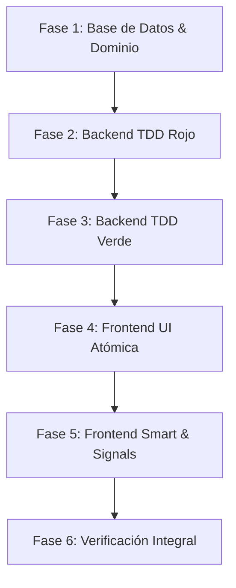

# Plan de Arquitectura e Implementación: [KEY] - [Título de la Funcionalidad]

**Jira Issue**: [[KEY]](https://tu-empresa.atlassian.net/browse/[KEY])  
**Especificación Técnica**: [[KEY].spec.md]([KEY].spec.md)  
**Estado**: [Aprobado]  

---

## 1. Estrategia de Entrega por Fases Secuenciales

---

## 2. Fases de Ejecución

### Fase 1: Persistencia y Dominio
1. Definir Entidad y Eventos de Dominio en `Core/Domain`.
2. Contratos de `IRepository` e `IDomainService`.
3. Mapeo EF Core Fluent API y migración en `Infrastructure/Persistence`.

### Fase 2: Backend TDD Fase Roja (Failing Tests)
1. Escribir pruebas unitarias con xUnit, Moq y FluentAssertions para CommandHandler, Validator y QueryHandler.
2. Ejecutar prueba focalizada: `dotnet test --filter FullyQualifiedName~<FeatureName>` (debe fallar en Red).

### Fase 3: Backend Implementación Fase Verde (Passing Tests)
1. Implementar CommandHandler, Validator, Finder y Controller con `[HasPermission]`.
2. Ejecutar prueba focalizada hasta alcanzar 100% verde (Green).

### Fase 4: Frontend Atomic Design en `shared/ui/`
1. Verificar componentes existentes.
2. Implementar o ajustar átomos, moléculas u organismos requeridos con Tailwind CSS y accesibilidad.

### Fase 5: Frontend Smart Component y Estado Reactivo
1. Crear DTOs y servicio HTTP en `features/<feature>/services/`.
2. Crear Smart Component con `rxResource`, `OnPush`, `*ngxPermissionsOnly` y Signals.
3. Pruebas unitarias en Jest: `cmd.exe /c npm test -- -t "<FeatureName>"`.

### Fase 6: Verificación Integral y Limpieza
1. Compilación limpia global: `dotnet build` y `npm run build`.
2. Actualizar grafo de conocimiento: `graphify update .`.
