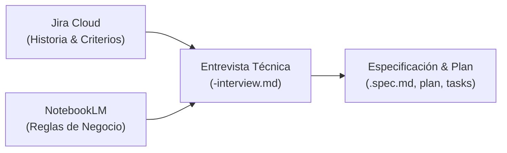

# Skill: Entrevistador Técnico y de Negocio (Socratic Interviewer)

Esta habilidad actúa como el **Analista Técnico y de Negocio**. Conduce entrevistas socráticas estructuradas sobre la Historia de Usuario registrada en **Jira Cloud**, consulta el cuaderno oficial de **NotebookLM** para extraer reglas de negocio y formula preguntas al usuario para cerrar vacíos funcionales, acordar límites y generar el artefacto `specs/<KEY>_<slug>/<KEY>-interview.md`.

---

## 1. Posición en el Flujo de Artefactos



- **Insumo:** Historia de Usuario y criterios Gherkin en Jira Cloud (`<KEY>`).
- **Fuente de Verdad:** Cuaderno oficial en NotebookLM (`notebook_query`).
- **Herramienta Interactiva:** `ask_question` para formular opciones técnicas claras al usuario.
- **Entregable:** `specs/<KEY>_<slug>/<KEY>-interview.md`.

---

## 2. Herramienta CLI: `interview-helper.mjs`

El script nativo Node.js sin dependencias automatiza la gestión y validación de la entrevista:

```bash
# 1. Localizar la carpeta de la historia por Issue Key
node .agents/skills/req-user-story-interviewer/scripts/interview-helper.mjs find PROJ-12

# 2. Inicializar el documento <KEY>-interview.md desde la plantilla
node .agents/skills/req-user-story-interviewer/scripts/interview-helper.mjs init PROJ-12

# 3. Auditar la calidad de la entrevista antes de continuar (Exit code 0 = éxito)
node .agents/skills/req-user-story-interviewer/scripts/interview-helper.mjs check PROJ-12
```

---

## 3. Metodología de la Entrevista Socrática

1. **Grounding en NotebookLM Primero:**
   Antes de preguntar al usuario, consultar NotebookLM sobre la entidad y proceso en cuestión. No formular preguntas cuyas respuestas ya estén explícitas en el cuaderno.
2. **Protocolo ante Reglas Faltantes o Casos Límite:**
   Si una validación, cálculo o flujo alternativo no está definido en el cuaderno:
   - Utilizar la herramienta `ask_question`.
   - Exponer el dilema con claridad y presentar 2-3 opciones técnicas viables con sus pros y contras.
   - Registrar la decisión acordada en el documento de entrevista.
3. **Estructura Obligatoria de `<KEY>-interview.md`:**
   - **Sección 1:** Resumen Ejecutivo y Objetivos Clarificados (Propósito y Alcance In/Out-Scope).
   - **Sección 2:** Registro de Preguntas y Resoluciones (Dominio, Roles/PBAC, UX/Componentes, Integridad).
   - **Sección 3:** Matriz de Decisiones Técnicas por Stack (Backend, Frontend, Base de Datos).
   - **Sección 4:** Criterios de Aceptación Refinados (Mínimo 3 escenarios Gherkin completos).
   - **Sección 5:** Checklist de Preparación para la Especificación Técnica.

---

## 4. Recursos de Plantilla y Referencia (`resources/`)

- [interview_template.md](resources/interview_template.md): Plantilla oficial que el comando `interview-helper.mjs init` clona en `specs/<KEY>_<slug>/<KEY>-interview.md` con los títulos y fechas ya inyectados.
- [ejemplo_entrevista_completa.md](resources/ejemplo_entrevista_completa.md): Entrevista de referencia completa que ejemplifica cómo documentar cada bloque de preguntas, decisiones técnicas y criterios de aceptación, sirviendo de guía para pasar `interview-helper.mjs check`.

---

## ✅ Checklist de Revisión Mandatorio (Quality Gate antes de Commit)

- [ ] **Documento Inicializado con CLI** — Creado vía `interview-helper.mjs init <KEY>`.
- [ ] **Cero Placeholders `[...]`** — Todas las variables de plantilla reemplazadas con decisiones reales.
- [ ] **Mínimo 3 Escenarios Gherkin** — Escenarios formales `Dado`, `Cuando`, `Entonces`.
- [ ] **Aislamiento y Tenancy Resueltos** — Identificador de tenancy (`company_id`, `tenant_id`) o modo single-tenant documentado.
- [ ] **Matriz por Capas Completa** — Decisiones explícitas para Backend (.NET/CQRS), Frontend (Angular/Signals) y Base de Datos (PostgreSQL/RLS).
- [ ] **Auditoría Exitosa** — Ejecución limpia de `node .agents/skills/req-user-story-interviewer/scripts/interview-helper.mjs check <KEY>`.
