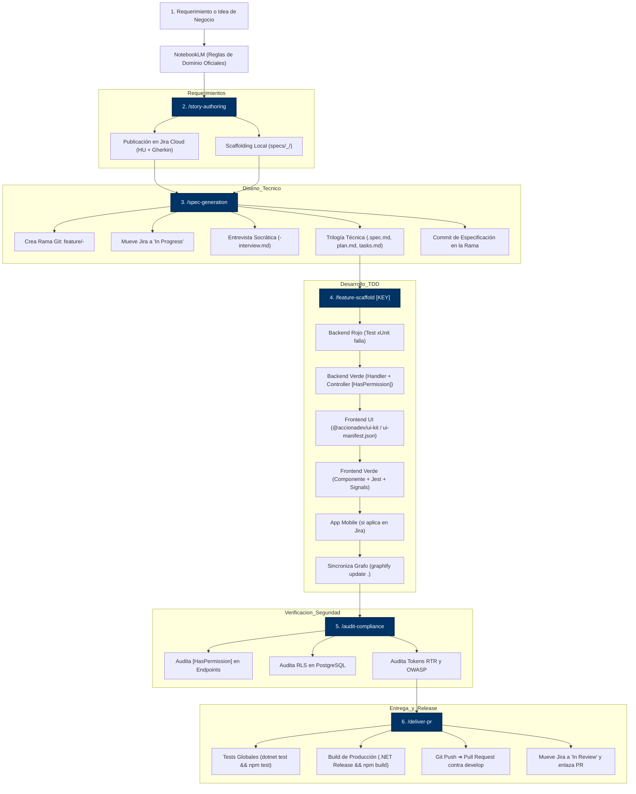

# Guía Maestra de Operaciones: Metodología, Workflows y Skills (AGENTS.md)

> **Destinatarios:** Ingenieros de Software, Arquitectos y Agentes de Inteligencia Artificial (Antigravity, Cursor, Claude, Copilot).  
> **Propósito:** Manual unificado de vuelo para gobernar el ciclo de vida del software, la arquitectura técnica y el uso de automatizaciones en este repositorio.

---

## 1. Filosofía Arquitectónica y Estándares Base

Este repositorio opera bajo una arquitectura empresarial de alta escalabilidad, seguridad bancaria y desacoplamiento estricto:

* **Backend (.NET 10 / C# 13):** Clean Architecture concéntrica (Onion Architecture).
  * Los Command Handlers **NUNCA** inyectan `DbContext`; inyectan exclusivamente `IRepository`, `IDomainService` e `IUnitOfWork`.
  * Las Queries usan `IFinder` con lectura optimizada `.AsNoTracking()`.
  * Patrón de resultados tipados con `ErrorOr<T>` y respuestas RFC 7807 (ProblemDetails).
* **Frontend (Angular 22+ Zoneless):**
  * Detección de cambios sin ZoneJS (`provideZonelessChangeDetection()`).
  * Rehidratación de sesión y permisos en arranque/`F5` mediante `provideAppInitializer()` consumiendo `GET /api/v1/auth/me` y Silent Refresh Token Rotation en `tokenInterceptor`.
  * Reactividad pura con **Signals**, `computed()`, `effect()` y `rxResource`.
  * Consumo del Sistema de Diseño desacoplado **`@accionadev/ui-kit`** (`../ui-design-system/ui-manifest.json`, prefijo `<ad-*>`, estética Fluent con variables CSS `--ad-*`), vista transversal `StatusPageComponent` (`403` `/forbidden` y `404` `/not-found` / `**`), separación `auth/` vs `features/` y grillas responsive de Tailwind CSS v3 (sin colores `#hex` arbitrarios).
  * Pruebas unitarias ejecutadas con **Jest** (`jest-preset-angular` Zoneless).
* **Seguridad y PBAC (Permission-Based Access Control):**
  * Cero endpoints de negocio con `[Authorize]` genérico sin política; cada endpoint de dominio/administración requiere `[HasPermission(Permissions.<Feature>.<Action>)]` (única excepción transversal de sesión propia: `GET /api/v1/auth/me` y `POST /api/v1/auth/logout`).
  * En el frontend, cada botón de acción sensible está condicionado con `*ngxPermissionsOnly="['...']"`.
  * Aislamiento multi-tenant a nivel de base de datos con **PostgreSQL Row Level Security (RLS)**.
  * Refresh Tokens con rotación estricta (**RTR**), hashing SHA-256 y detección automática de intrusiones.
* **Trazabilidad Jira-First y Prohibición de Atajos No Regulados:**
  * Jira Cloud es la fuente única de verdad de Historias de Usuario (HUs) y criterios de aceptación en Gherkin.
  * En Git **no se duplican archivos `.md` de historias**; la carpeta `specs/<KEY>_<slug>/` contiene exclusivamente planos técnicos de ingeniería.
  * Prohibido escribir código de negocio sin especificación técnica previa en `specs/<KEY>_<slug>/`, hacer commits directos a `main`/`develop` fuera de ramas `feature/<KEY>-<slug>` o omitir `[HasPermission]` / `*ngxPermissionsOnly`.

---

## 2. Estructura Canónica del Repositorio (Segregación en `src/`)

Para evitar la contaminación de la raíz (*root clutter*) y colisiones de herramientas entre Node y .NET, el código fuente reside exclusivamente en subdirectorios bajo `src/`:

```text
.
├── .agents/                 # 🤖 Inteligencia Artificial (Reglas y 23 Skills: 8 Orquestadoras + 15 Especialistas)
├── AGENTS.md                # 📖 Manual Maestro de Operaciones (Auto-cargado por Antigravity)
├── README.md                # 📄 Portada del repositorio
├── .env.example             # 🔑 Plantilla de variables de entorno
├── .gitignore               # 🚫 Exclusiones de Git
├── docker-compose.yml       # 🐳 PostgreSQL 16 + Redis locales
│
├── specs/                   # 📐 Especificaciones de Ingeniería (specs/KEY_slug/)
│
└── src/                     # 📂 CÓDIGO FUENTE SEPARADO POR PLATAFORMA
    ├── backend/             # 🟦 Solución .NET 10 (Onion Architecture concéntrica, 1 tipo por archivo .cs)
    │   ├── src/             # Core (Domain, Application), Infrastructure (Authentication, ExternalServices, Persistence, Shared), Presentation (Web.API)
    │   ├── tests/           # Tests.UnitTests (estructura espejo), Tests.IntegrationTests (WebApplicationFactory)
    │   └── EnterpriseApp.sln# Solución .NET clásica (--format sln)
    │
    ├── frontend/            # 🔴 Frontend Angular 22+ (Zoneless, Signals, Jest, conectado a @accionadev/ui-kit)
    │   ├── src/             # environments/ + app/ (auth/, features/, layout/, shared/pages/, core/)
    │   ├── package.json     # Dependencias de npm
    │   └── angular.json     # Configuración de Angular
    │
    └── mobile/              # 📱 Aplicación Móvil (si aplica en el proyecto)
```

---

## 3. El Ciclo de Vida del Software (Diagrama Visual)

Cualquier cambio en este repositorio sigue este flujo formal de extremo a extremo:



---

## 4. Matriz de Decisiones ("¿Qué comando debo usar?")

Ubica tu objetivo en la siguiente tabla para saber exactamente qué flujo ejecutar:

| Si tu objetivo es... | Comando Slash | Insumos Requeridos | Resultado / Entregable |
| :--- | :--- | :--- | :--- |
| **Empezar un proyecto desde cero** | `/project-init` | Cuaderno NotebookLM | Solución .NET 10 + Angular 22 + Docker Compose + CI configurada en `develop`. |
| **Definir una nueva Historia de Usuario** | `/story-authoring` | Concepto de negocio / NotebookLM | Ticket creado en Jira Cloud con Gherkin y carpeta `specs/<KEY>_<slug>/` lista. |
| **Diseñar la arquitectura técnica de una HU** | `/spec-generation <KEY>` | Clave de Jira (ej: `POJ-12`) | Rama `feature/<KEY>-<slug>` activa, Jira "En curso" y suite técnica aprobada (`.spec.md`, `plan.md`, `tasks.md`). |
| **Programar la funcionalidad con TDD** | `/feature-scaffold [KEY]` | Rama de feature activa + `tasks.md` | Código backend + frontend 100% probado en Verde y tareas marcadas en `tasks.md`. |
| **Corregir un bug o defecto sin regresiones** | `/bugfix-forensic` | Descripción o log del error | Prueba en Rojo que reproduce el bug, fix mínimo quirúrgico, prueba en Verde y 0 regresiones. |
| **Auditar seguridad, RLS y permisos PBAC** | `/audit-compliance <KEY>` | `<KEY>` (Surgical) o `--all` (Global) | Informe formal de vulnerabilidades SEC con severidad y remediación inmediata. |
| **Entregar la feature y abrir Pull Request** | `/deliver-pr` | Suite de pruebas en verde | Commit convencional, PR abierto contra `develop` y Jira en "En revisión" con el link. |
| **Explorar el código sin gastar tokens** | `/knowledge-graph` | Nombre de clase, módulo o ruta | Subgrafo AST instantáneo con las dependencias y llamadas exactas. |

---

## 5. Las 8 Skills Orquestadoras / Comandos Slash (La Columna Vertebral)

Las skills orquestadoras residen en `.agents/skills/<nombre>/SKILL.md` (habilitando comandos slash de primer nivel `/<nombre>` y autodescubrimiento semántico) y están redactadas en inglés para optimizar el contexto de la IA (~30% de ahorro de tokens):

1. **`project-init/SKILL.md` (`/project-init`):**
   Bootstrap integral: valida `.env` y `.gitignore` (excluyendo caché de Graphify), levanta `docker-compose.yml` (PostgreSQL 16 + Redis 7), genera la solución Onion .NET 10 en `src/backend/` y Standalone Angular 22+ en `src/frontend/`, ejecuta migraciones con `InitialDataSeeder` (Admin + permisos), configura CI en `.github/workflows/ci.yml` e inicializa Gitflow.
2. **`story-authoring/SKILL.md` (`/story-authoring`):**
   Conecta con NotebookLM, extrae invariantes, redacta la historia en formato Scrum con criterios Gherkin, la publica vía `jira_client.js create` en Jira Cloud y prepara la carpeta local `specs/<KEY>_<slug>/`.
3. **`spec-generation/SKILL.md` (`/spec-generation <KEY>`):**
   Descarga la historia de Jira, sincroniza `develop`, crea la rama `feature/<KEY>-<slug>`, transiciona el ticket a "In Progress", consulta dependencias con Graphify, conduce la entrevista técnica (`<KEY>-interview.md`), genera la especificación (`.spec.md`, `plan.md`, `tasks.md`) y hace commit en la rama de la feature.
4. **`feature-scaffold/SKILL.md` (`/feature-scaffold [KEY]`):**
   Toma las micro-tareas de `tasks.md` dentro de la rama de la feature y ejecuta el ciclo TDD: Backend Rojo (xUnit) ➔ Backend Verde (Handler + Controller) ➔ Frontend UI Atómica ➔ Frontend Smart (Jest + Signals) ➔ Mobile (si aplica) ➔ `graphify update .`.
5. **`bugfix-forensic/SKILL.md` (`/bugfix-forensic`):**
   Diagnóstico con `graphify path`, redacción de test automatizado que falla demostrando el defecto (Rojo), corrección quirúrgica hasta que pase (Verde) y verificación de seguridad.
6. **`audit-compliance/SKILL.md` (`/audit-compliance`):**
   Soporta modo **Quirúrgico** (`/audit-compliance <KEY>`, escanea solo archivos tocados por la feature) y modo **Global** (`--all`). Valida que el 100% de endpoints tengan `[HasPermission]`, verifica políticas PostgreSQL RLS, rotación RTR y directiva `*ngxPermissionsOnly`.
7. **`deliver-pr/SKILL.md` (`/deliver-pr`):**
   Ejecuta suite global (`dotnet test`, `npm test`), build de producción, actualiza el grafo, genera commit convencional, hace push a origin, abre el Pull Request hacia `develop` con `github_client.js` y actualiza Jira con el enlace del PR.
8. **`knowledge-graph/SKILL.md` (`/knowledge-graph`):**
   Navega la arquitectura con Graphify (`query`, `path`, `explain`) para responder dudas técnicas sin saturar el contexto de la IA.

---

## 6. Catálogo de Skills Especialistas

Las 15 skills técnicas especialistas en `.agents/skills/<nombre>/SKILL.md` son invocadas por los orquestadores (o bajo demanda) para ejecutar tareas concretas:

### Frontend (Angular 22+ & UI)
* `fe-angular-scaffold`: Scaffolding de proyectos Angular Standalone, Zoneless, Jest, guardias PBAC y enlace a `@accionadev/ui-kit` (`../../../ui-design-system`).
* `fe-angular-feature`: Construcción de Smart Components, servicios HTTP, Signal Stores, control de flujo moderno y consumo/delegación hacia `@accionadev/ui-kit` (`../ui-design-system/ui-manifest.json`).
* `fe-angular-test`: Pruebas unitarias e integración con Jest para componentes, servicios y guards.
* *(Nota: La skill `fe-design-system` vive de forma centralizada en el repositorio hermano `../ui-design-system/.agents/skills/fe-design-system/SKILL.md`).*

### Backend (.NET 10 & Datos)
* `be-dotnet-scaffold`: Inicialización de soluciones Onion de 7 capas, seguridad ultraligera y middleware RFC 7807.
* `be-dotnet-feature`: Vertical slices, MediatR Handlers, validadores FluentValidation, Finders y controladores PBAC.
* `be-dotnet-test`: Pruebas TDD automatizadas con xUnit, Moq y FluentAssertions.
* `be-database-sp`: Procedimientos almacenados PostgreSQL, Dapper, y políticas Row Level Security (RLS).

### Requerimientos & Gestión de Producto
* `req-user-story-creator`: Redacción estructurada de HUs en Gherkin y publicación automatizada en Jira Cloud.
* `req-user-story-interviewer`: Entrevistas socráticas interactivas con `ask_question` para cerrar casos borde de arquitectura y UX.
* `req-technical-spec-generator`: Generación de la suite formal de ingeniería (`.spec.md`, `plan.md`, `tasks.md`).
* `req-jira`: Cliente API directo para crear, consultar y transicionar tickets en Jira Cloud.

### Plataforma, Seguridad & Control de Versiones
* `ops-github-gitflow`: Automatización de ramas (`feature/*`, `develop`, `main`), commits convencionales y Pull Requests.
* `ops-security-audit`: Auditoría de vulnerabilidades OWASP Top 10, permisos PBAC, tokens RTR y fugas de secretos.
* `graphify`: Análisis de AST y grafos de conocimiento de código para optimización extrema de tokens.

---

## 7. Las 7 Reglas de Oro Inviolables del Código

1. **Cero `DbContext` en Application:** Los Command Handlers inyectan exclusivamente `IRepository`, `IDomainService` e `IUnitOfWork`. La persistencia concreta está aislada en Infrastructure (`src/backend/src/Infrastructure`).
2. **Cero `[Authorize]` Genéricos:** Todo endpoint de controlador debe estar decorado con `[HasPermission(Permissions.<Feature>.<Action>)]` o `[AllowAnonymous]`.
3. **Cero Mutaciones Desprotegidas en UI:** Todo botón de creación, edición o borrado en Angular debe condicionarse con `*ngxPermissionsOnly="['...']"`.
4. **TDD Estricto (Rojo antes de Verde):** Queda terminantemente prohibido implementar lógica de negocio o controladores sin haber escrito primero la prueba unitaria que falla.
5. **Gitflow Inquebrantable:** Prohibido realizar commits directos a `main` o `develop`. Todo cambio nace en una rama `feature/<KEY>-<slug>` y se integra exclusivamente a través de Pull Request validado por la suite de pruebas.
6. **Cero UI Nativa Improvisada (`@accionadev/ui-kit` Primero):** Regulado en [.agents/rules/ui-design-system-first.md](.agents/rules/ui-design-system-first.md). Ante cualquier solicitud de UI (incluso un simple botón, tarjeta, ícono, input, modal o tabla), es obligatorio consultar `../ui-design-system/ui-manifest.json` e importar `<ad-*>` desde `'@accionadev/ui-kit'`. Prohibido escribir `<button>`, `<input>`, `<svg>` manuales o tarjetas CSS sueltas en `src/frontend/`.
7. **Cero Commits ni Push Automáticos:** Regulado en [.agents/rules/git-commit-policy.md](.agents/rules/git-commit-policy.md). Queda prohibido ejecutar `git commit` o `git push` de forma automática en cualquier workflow (`/project-init`, `/story-authoring`, `/spec-generation`, `/feature-scaffold`, `/bugfix-forensic`). Solo se permite cuando el usuario lo solicite explícitamente o al invocar `/deliver-pr`.

---

## 8. Privacidad, Confidencialidad y Cumplimiento de NDA

Regulado formalmente bajo [.agents/rules/data-privacy-confidentiality.md](.agents/rules/data-privacy-confidentiality.md):

* **Almacenamiento Local Estricto:** Todo el código, especificaciones técnicas y esquemas de base de datos residen en la máquina local y en repositorios corporativos privados.
* **Prohibición Total de Exfiltración:** Queda prohibido subir fragmentos de código, esquemas o reglas de negocio a servicios públicos de la nube, foros o APIs no autorizadas.
* **Búsquedas Web Genéricas:** Las consultas a internet (`search_web`) están limitadas a documentación técnica oficial pública. Queda prohibido incluir nombres de clientes, entidades de negocio o fragmentos de código en búsquedas externas.
* **Cero Secretos en Código:** Tokens, contraseñas y cadenas de conexión residen exclusivamente en `.env` (ignorado en `.gitignore`).

---

## 9. Cheat Sheet de Comandos Slash

Copia y pega estos comandos en el chat con la IA según la fase en la que te encuentres:

```text
# 1. Inicializar solución completa desde cero (crea src/backend, src/frontend, docker-compose y CI)
/project-init

# 2. Redactar una Historia de Usuario y subirla a Jira
/story-authoring

# 3. Diseñar la arquitectura técnica de una HU existente
/spec-generation <KEY>            # Ejemplo: /spec-generation POJ-12

# 4. Programar la funcionalidad con TDD (dentro de la rama feature)
/feature-scaffold [KEY]           # Ejemplo: /feature-scaffold POJ-12

# 5. Diagnosticar y corregir un bug con pruebas de regresión
/bugfix-forensic

# 6. Auditar seguridad y permisos
/audit-compliance <KEY>           # Quirúrgico para una feature (Ej: /audit-compliance POJ-12)
/audit-compliance --all           # Global de todo el proyecto

# 7. Ejecutar suite de pruebas, commit, push y abrir PR hacia develop
/deliver-pr

# 8. Consultar la arquitectura del código
/knowledge-graph                  # O en terminal: graphify query "<Clase>"
```

---

## 10. Inclusiones de Reglas Especializadas (.agents/rules/)

@[data-privacy-confidentiality](.agents/rules/data-privacy-confidentiality.md)
@[endpoint-permissions-rbac](.agents/rules/endpoint-permissions-rbac.md)
@[git-commit-policy](.agents/rules/git-commit-policy.md)
@[graphify](.agents/rules/graphify.md)
@[notebooklm](.agents/rules/notebooklm.md)
@[token-optimization](.agents/rules/token-optimization.md)
@[ui-design-system-first](.agents/rules/ui-design-system-first.md)


