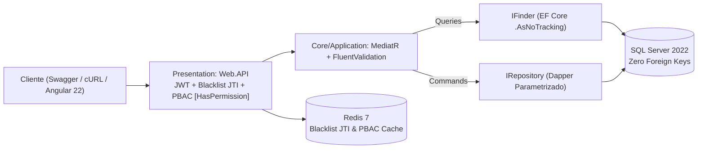

# Redarbor Product Inventory Management System

Solución Full-Stack para la gestión integral de inventario de productos (Categorías, Productos y Kardex de Movimientos), construida bajo **Clean / Onion Architecture en .NET 10**, **CQRS con MediatR**, separación explícita de persistencia (**Entity Framework Core para lecturas** + **Dapper para escrituras**), base de datos **SQL Server 2022 dockerizada sin llaves foráneas (`FOREIGN KEYS`)**, seguridad **OAuth2/JWT con control granular PBAC**, pruebas automatizadas bajo **TDD**, documentación **Swagger/OpenAPI** y cliente web SPA en **Angular 22+ Zoneless**.

---

## 1. Matriz de Cumplimiento — Prueba Técnica Redarbor

| Requisito de la Prueba | Implementación en este Repositorio | Evidencia / Ubicación |
| :--- | :--- | :--- |
| **.NET 6.0 / .NET Core+** | **.NET 10 / C# 13** en solución modular de 9 proyectos (`Domain`, `Application`, 4 capas `Infrastructure`, `Web.API`, `Tests.UnitTests`, `Tests.IntegrationTests`). | [EnterpriseApp.sln](src/backend/EnterpriseApp.sln) |
| **SQL Server dockerizado** | Contenedor `redarbor-sqlserver` (`mssql/server:2022-latest`) con `healthcheck` y migraciones automáticas al iniciar la API. | [docker-compose.yml](docker-compose.yml) |
| **Cero `FOREIGN KEYS` en BD** | **0 restricciones `FOREIGN KEY`** en todas las tablas; relaciones por ID escalar (`CategoryId`, `ProductId`, `RoleId`, `UserId`, `PerformedByUserId`) con índices dedicados. | [Migrations](src/backend/src/Infrastructure/Persistence/Migrations) |
| **EF Core lectura / Dapper escritura** | `IFinder` lee exclusivamente con EF Core `.AsNoTracking()`; `IRepository` ejecuta `INSERT` / `UPDATE` / `DELETE` parametrizados con **Dapper** (`CommandDefinition` + transacciones SQL en Kardex). | [Finders](src/backend/src/Infrastructure/Persistence/Finders) / [Repositories](src/backend/src/Infrastructure/Persistence/Repositories) |
| **CQRS + Patrones + SOLID** | MediatR (`ICommand`/`IQuery`), `FluentValidation` (`ValidationBehavior`), `ErrorOr<T>`, `ProblemDetails` RFC 7807, Unit of Work y Domain Events. | [Application](src/backend/src/Core/Application) |
| **CRUD Categorías y Productos** | Endpoints RESTful `POST`, `GET` (paginado + filtros), `GET /{id}`, `PUT /{id}` y `DELETE /{id}` con reglas de unicidad e integridad referencial lógica. | [CategoriesController.cs](src/backend/src/Presentation/Web.API/Controllers/CategoriesController.cs) / [ProductsController.cs](src/backend/src/Presentation/Web.API/Controllers/ProductsController.cs) |
| **Movimientos de Inventario (Kardex)** | Registro transaccional atómico de `ENTRY` y `EXIT` con actualización optimista condicional (`Stock = @PreviousStock`) y bloqueo de borrado de productos con historial/stock. | [InventoryMovementsController.cs](src/backend/src/Presentation/Web.API/Controllers/InventoryMovementsController.cs) |
| **Autenticación OAuth2 / JWT** | Bearer JWT ultraligero + Refresh Token Rotation (RTR, hash SHA-256) + detección de reuso + Blacklist JTI `O(1)` en Redis + PBAC `[HasPermission(...)]`. | [AuthController.cs](src/backend/src/Presentation/Web.API/Controllers/AuthController.cs) |
| **Dockerización un solo comando** | `docker-compose.yml` orquesta `sqlserver`, `redis` y `api` (`src/backend/Dockerfile`) con un solo `docker compose up -d --build`. | [docker-compose.yml](docker-compose.yml) / [Dockerfile](src/backend/Dockerfile) |
| **Swagger / OpenAPI** | Documentación interactiva habilitada con esquema Bearer JWT en `/swagger`. | [SwaggerExtensions.cs](src/backend/src/Presentation/Web.API/Infrastructure/SwaggerExtensions.cs) |
| **Pruebas Unitarias e Integración** | **99** unit tests + **14** integration tests (`Tests.UnitTests` + `Tests.IntegrationTests`) y **41** unit tests Jest en Frontend. | [src/backend/tests](src/backend/tests) |
| **7 Reglas Clean Code de Redarbor** | Código 100% en inglés, 0 comentarios innecesarios, métodos `<= 25` líneas, anidamiento `<= 1`, config vía env vars, 1 tipo por archivo y parámetros por objeto. | [redarbor-clean-code.md](.agents/rules/redarbor-clean-code.md) |
| **Declaración Obligatoria de IA** | Documentación completa de herramientas, fases SDD, revisión, verificación y control de tokens. | [Sección 7](#7-declaración-de-uso-de-ia-orquestación-y-validación-requisito-redarbor) |

---

## 2. Arquitectura y Diseño de Base de Datos

### Flujo Onion + CQRS (EF Core Read / Dapper Write)



### Estructura del Repositorio

```text
.
├── .env.example                 # Plantilla de variables de entorno (BD, Redis, JWT, Seed, CORS)
├── docker-compose.yml           # Stack Docker completo: SQL Server 2022 + Redis 7 + Web API (.NET 10)
├── AGENTS.md                    # Guía operativa y reglas de ingeniería para desarrollo asistido por IA
├── PROJECT_PROFILE.md           # Perfil arquitectónico sellado del proyecto
├── docs/                        # Enunciado oficial de la prueba técnica
├── specs/                       # Especificaciones SDD por Historia de Usuario (US-001, US-002, US-003)
└── src/
    ├── backend/
    │   ├── Dockerfile
    │   ├── EnterpriseApp.sln
    │   ├── src/
    │   │   ├── Core/Domain/                     # Entidades, ValueObjects, DomainEvents, Permissions
    │   │   ├── Core/Application/                # Commands, Queries, Validators, DTOs, Interfaces
    │   │   ├── Infrastructure/Persistence/      # EF Core AppDbContext/Finders + Dapper Repositories + Migrations
    │   │   ├── Infrastructure/Authentication/   # JwtProvider, PasswordHasher (BCrypt), TokenBlacklist, PermissionCache
    │   │   ├── Infrastructure/Shared/           # Redis/Memory CacheService + DateTimeProvider
    │   │   ├── Infrastructure/ExternalServices/ # HttpClient infraestructura
    │   │   └── Presentation/Web.API/            # Controllers, Middlewares, HealthChecks, Swagger, Web.API.http
    │   └── tests/
    │       ├── Tests.UnitTests/                 # 99 pruebas unitarias espejo (xUnit + Moq + FluentAssertions)
    │       └── Tests.IntegrationTests/          # 14 pruebas E2E con CustomWebApplicationFactory
    └── frontend/                                # SPA Angular 22+ Standalone Zoneless + Signals + Jest (41 tests)
```

### Esquema SQL Server sin Foreign Keys (`FOREIGN KEY`)

Las cuatro migraciones EF Core en [Migrations](src/backend/src/Infrastructure/Persistence/Migrations) crean las tablas sin ninguna restricción `FOREIGN KEY`, manteniendo trazabilidad por identificadores GUID e índices únicos/compuestos:

* `Categories`: `Id`, `Code` (único), `Name` (único), `Description`, `IsActive`, `CreatedAtUtc`, `UpdatedAtUtc`.
* `Products`: `Id`, `Sku` (único), `Name`, `Description`, `CategoryId` (índice sin FK), `Price`, `Stock`, `MinStock`, `IsActive`, `CreatedAtUtc`, `UpdatedAtUtc`.
* `InventoryMovements`: `Id`, `ProductId` (índice sin FK), `Type` (`ENTRY` | `EXIT`), `Quantity`, `PreviousStock`, `NewStock`, `Reason`, `PerformedByUserId` (índice sin FK), `CreatedAtUtc`.
* Seguridad PBAC: `Users`, `Roles`, `Permissions`, `RolePermissions`, `RefreshTokens` (sin FKs).

---

## 3. Configuración, Despliegue y Depuración Local

### Paso 1: Configurar Variables de Entorno

Copia la plantilla `.env.example` hacia `.env` en la raíz del repositorio:

```powershell
Copy-Item .env.example .env
```

Variables principales leídas por [EnvironmentLoader.cs](src/backend/src/Presentation/Web.API/Infrastructure/EnvironmentLoader.cs) e `IConfiguration`:

| Variable | Valor por defecto en `.env.example` | Propósito |
| :--- | :--- | :--- |
| `DB_HOST` / `DB_PORT` | `localhost` / `1433` | Host y puerto de SQL Server 2022 (`sqlserver` dentro de Docker) |
| `DB_NAME` / `DB_USER` / `DB_PASSWORD` | `RedarborInventoryDb` / `sa` / `RedarborStrongPass123!` | Base de datos y credenciales de SQL Server |
| `REDIS_PORT` | `6379` | Puerto de Redis 7 (`redis:6379` dentro de Docker) |
| `JWT_SECRET_KEY` | Clave HMAC-SHA256 (>= 32 bytes) | Firma simétrica de tokens JWT |
| `JWT_ISSUER` / `JWT_AUDIENCE` | `RedarborInventoryApi` / `RedarborInventoryClient` | Emisor y audiencia validados en el Bearer token |
| `JWT_ACCESS_TOKEN_MINUTES` | `15` | Minutos de vigencia del Access Token |
| `CORS_ALLOWED_ORIGINS` | `http://localhost:4200` | Orígenes CORS permitidos para el frontend |
| `SEED_ADMIN_EMAIL` / `SEED_ADMIN_PASSWORD` | `admin@enterprise.local` / `Admin123*` | Usuario administrador creado automáticamente al iniciar |
| `SEED_USER_EMAIL` / `SEED_USER_PASSWORD` | `user@enterprise.local` / `User123*` | Usuario operador estándar creado automáticamente al iniciar |

---

### Opción A: Levantar API + SQL Server + Redis en Docker (Un Solo Comando)

Ideal para evaluar y probar toda la solución contenerizada de inmediato:

```powershell
docker compose up -d --build
docker compose ps
```

Al iniciar, el contenedor `redarbor-api` espera a que `redarbor-sqlserver` y `redarbor-redis` estén `healthy`, aplica automáticamente las migraciones de EF Core e inserta permisos, roles y usuarios semilla:

* **Swagger UI (Docker):** http://localhost:5080/swagger
* **API Base URL (Docker):** `http://localhost:5080`
* **Health Checks:** `GET http://localhost:5080/health` y `GET http://localhost:5080/health/ready`

Para ver logs en tiempo real o detener contenedores:

```powershell
docker compose logs -f api
docker compose down
```

---

### Opción B: Ejecución y Depuración Local (IDE / CLI)

Recomendada cuando se desea compilar, depurar con breakpoints desde Visual Studio / VS Code / Rider y correr el frontend en desarrollo:

1. **Levantar únicamente SQL Server 2022 y Redis 7 en Docker:**
   ```powershell
   docker compose up -d sqlserver redis
   docker compose ps
   ```
2. **Restaurar, compilar y ejecutar la Web API (.NET 10):**
   ```powershell
   dotnet restore src/backend/EnterpriseApp.sln
   dotnet build src/backend/EnterpriseApp.sln
   dotnet run --project src/backend/src/Presentation/Web.API/Web.API.csproj
   ```
   * **Swagger UI (Local):** http://localhost:5000/swagger (perfil `http` de `launchSettings.json`, o `https://localhost:7104/swagger` con perfil `https`).
   * **Colección HTTP integrada:** Abrir [Web.API.http](src/backend/src/Presentation/Web.API/Web.API.http) desde Visual Studio o VS Code REST Client.
3. **(Opcional) Ejecutar el Frontend Web Angular 22+:**
   > El frontend consume `@accionadev/ui-kit` enlazado desde `../../../ui-design-system` si se encuentra clonado como carpeta hermana, o directamente desde `node_modules` si ya está empaquetado.
   ```powershell
   cd src/frontend
   npm install --legacy-peer-deps
   npm start
   ```
   * **Aplicación Web:** http://localhost:4200

---

## 4. Datos de Ejemplo y Guía Paso a Paso para Probar la API

> [!NOTE]
> En los comandos siguientes puedes usar `http://localhost:5000` (ejecución local con `dotnet run`) o `http://localhost:5080` (ejecución dockerizada con `docker compose up -d --build`). También dispones del flujo completo listo para clic-y-ejecutar en [Web.API.http](src/backend/src/Presentation/Web.API/Web.API.http).

### Credenciales Precargadas (Seeding Automático)

| Perfil | Email | Password | Permisos PBAC Asignados |
| :--- | :--- | :--- | :--- |
| **Administrador** | `admin@enterprise.local` | `Admin123*` | `Users.*`, `Roles.*`, `Categories.*`, `Products.*`, `InventoryMovements.*` |
| **Operador Estándar** | `user@enterprise.local` | `User123*` | `Categories.Read`, `Products.Read`, `InventoryMovements.Read` (solo lectura; cualquier mutación retorna `403 Forbidden`) |

---

### Paso 1: Autenticación OAuth2 / JWT

#### 1.1 Login (`POST /api/v1/auth/login`)

**Petición (cURL):**

```bash
curl -X POST http://localhost:5000/api/v1/auth/login \
  -H "Content-Type: application/json" \
  -d '{
    "email": "admin@enterprise.local",
    "password": "Admin123*"
  }'
```

**En PowerShell (guardando `$token` y `$refreshToken` para los siguientes pasos):**

```powershell
$baseUrl = "http://localhost:5000"
$login = Invoke-RestMethod -Method Post -Uri "$baseUrl/api/v1/auth/login" -ContentType "application/json" -Body '{"email":"admin@enterprise.local","password":"Admin123*"}'
$headers = @{ Authorization = "Bearer $($login.accessToken)" }
```

**Respuesta esperada (`200 OK`):**

```json
{
  "accessToken": "eyJhbGciOiJIUzI1NiIs...",
  "refreshToken": "Base64RefreshTokenValue...",
  "expiresAtUtc": "2026-11-15T18:10:00Z"
}
```

> Para probar en **Swagger UI**, haz clic en el botón **Authorize** (arriba a la derecha), pega el valor de `accessToken` y pulsa **Authorize**.

#### 1.2 Consultar identidad y permisos (`GET /api/v1/auth/me`) y rotar token (`POST /api/v1/auth/refresh`)

```bash
curl -X GET http://localhost:5000/api/v1/auth/me \
  -H "Authorization: Bearer <ACCESS_TOKEN>"

curl -X POST http://localhost:5000/api/v1/auth/refresh \
  -H "Content-Type: application/json" \
  -d '{
    "refreshToken": "<REFRESH_TOKEN>"
  }'
```

---

### Paso 2: CRUD de Categorías (`/api/v1/categories`)

#### 2.1 Crear Categoría (`POST /api/v1/categories`)

```bash
curl -X POST http://localhost:5000/api/v1/categories \
  -H "Authorization: Bearer <ACCESS_TOKEN>" \
  -H "Content-Type: application/json" \
  -d '{
    "code": "ELEC",
    "name": "Electrónica y Cómputo",
    "description": "Equipos portátiles, periféricos y accesorios de oficina"
  }'
```

**Respuesta esperada (`201 Created`):**

```json
{
  "id": "3fa85f64-5717-4562-b3fc-2c963f66afa6",
  "code": "ELEC",
  "name": "Electrónica y Cómputo",
  "description": "Equipos portátiles, periféricos y accesorios de oficina",
  "isActive": true,
  "createdAtUtc": "2026-11-15T18:00:00Z",
  "updatedAtUtc": null
}
```

#### 2.2 Listar, Consultar por ID, Actualizar y Eliminar Categoría

```bash
# Listar paginado con filtros opcionales (page, pageSize, search, isActive)
curl -X GET "http://localhost:5000/api/v1/categories?page=1&pageSize=10&isActive=true&search=ELEC" \
  -H "Authorization: Bearer <ACCESS_TOKEN>"

# Obtener por ID
curl -X GET "http://localhost:5000/api/v1/categories/<CATEGORY_ID>" \
  -H "Authorization: Bearer <ACCESS_TOKEN>"

# Actualizar
curl -X PUT "http://localhost:5000/api/v1/categories/<CATEGORY_ID>" \
  -H "Authorization: Bearer <ACCESS_TOKEN>" \
  -H "Content-Type: application/json" \
  -d '{
    "code": "ELEC",
    "name": "Electrónica Corporativa",
    "description": "Equipamiento tecnológico empresarial",
    "isActive": true
  }'

# Eliminar (retorna 204 No Content; si tiene productos asociados retorna 409 Conflict: Category.HasAssociatedProducts)
curl -X DELETE "http://localhost:5000/api/v1/categories/<CATEGORY_ID>" \
  -H "Authorization: Bearer <ACCESS_TOKEN>"
```

---

### Paso 3: CRUD de Productos (`/api/v1/products`)

#### 3.1 Crear Producto (`POST /api/v1/products`)

Usa el `id` de la categoría creada en el Paso 2 (`categoryId`):

```bash
curl -X POST http://localhost:5000/api/v1/products \
  -H "Authorization: Bearer <ACCESS_TOKEN>" \
  -H "Content-Type: application/json" \
  -d '{
    "sku": "LAP-PRO-14",
    "name": "Laptop Workstation 14 Pro",
    "description": "Portátil 16GB RAM, SSD 512GB NVMe",
    "categoryId": "<CATEGORY_ID>",
    "price": 1450.00,
    "initialStock": 10,
    "minStock": 4
  }'
```

**Respuesta esperada (`201 Created`):**

```json
{
  "id": "8a1c7d42-9b10-4b88-a7de-9f12c8832100",
  "sku": "LAP-PRO-14",
  "name": "Laptop Workstation 14 Pro",
  "description": "Portátil 16GB RAM, SSD 512GB NVMe",
  "categoryId": "<CATEGORY_ID>",
  "categoryCode": "ELEC",
  "categoryName": "Electrónica Corporativa",
  "price": 1450.00,
  "stock": 10,
  "minStock": 4,
  "isLowStock": false,
  "isActive": true,
  "createdAtUtc": "2026-11-15T18:02:00Z",
  "updatedAtUtc": null
}
```

#### 3.2 Listar con Filtros, Consultar, Actualizar y Eliminar Producto

```bash
# Listar con filtros (page, pageSize, categoryId, isActive, lowStockOnly, search)
curl -X GET "http://localhost:5000/api/v1/products?page=1&pageSize=10&categoryId=<CATEGORY_ID>&lowStockOnly=false&search=LAP" \
  -H "Authorization: Bearer <ACCESS_TOKEN>"

# Obtener por ID
curl -X GET "http://localhost:5000/api/v1/products/<PRODUCT_ID>" \
  -H "Authorization: Bearer <ACCESS_TOKEN>"

# Actualizar datos maestros (el Stock NO se edita aquí; solo mediante movimientos de inventario)
curl -X PUT "http://localhost:5000/api/v1/products/<PRODUCT_ID>" \
  -H "Authorization: Bearer <ACCESS_TOKEN>" \
  -H "Content-Type: application/json" \
  -d '{
    "sku": "LAP-PRO-14",
    "name": "Laptop Workstation 14 Pro Gen2",
    "description": "Portátil 32GB RAM, SSD 1TB NVMe",
    "categoryId": "<CATEGORY_ID>",
    "price": 1590.00,
    "minStock": 5,
    "isActive": true
  }'

# Eliminar (solo si stock == 0 y sin movimientos en Kardex; en caso contrario 409 Conflict: Product.CannotDeleteWithStockOrMovements)
curl -X DELETE "http://localhost:5000/api/v1/products/<PRODUCT_ID>" \
  -H "Authorization: Bearer <ACCESS_TOKEN>"
```

---

### Paso 4: Movimientos de Inventario / Kardex (`/api/v1/inventory-movements`)

#### 4.1 Registrar Entrada (`ENTRY`) y Salida (`EXIT`)

```bash
# Entrada de 15 unidades (stock pasa de 10 -> 25)
curl -X POST http://localhost:5000/api/v1/inventory-movements \
  -H "Authorization: Bearer <ACCESS_TOKEN>" \
  -H "Content-Type: application/json" \
  -d '{
    "productId": "<PRODUCT_ID>",
    "type": "ENTRY",
    "quantity": 15,
    "reason": "Ingreso por orden de compra OC-2026-0041"
  }'

# Salida de 4 unidades (stock pasa de 25 -> 21)
curl -X POST http://localhost:5000/api/v1/inventory-movements \
  -H "Authorization: Bearer <ACCESS_TOKEN>" \
  -H "Content-Type: application/json" \
  -d '{
    "productId": "<PRODUCT_ID>",
    "type": "EXIT",
    "quantity": 4,
    "reason": "Despacho a cliente factura FV-9821"
  }'
```

**Respuesta esperada (`201 Created`):**

```json
{
  "id": "e91a45c3-0c42-4810-91a4-7b8e1102a5f9",
  "productId": "<PRODUCT_ID>",
  "productSku": "LAP-PRO-14",
  "productName": "Laptop Workstation 14 Pro Gen2",
  "type": "EXIT",
  "quantity": 4,
  "previousStock": 25,
  "newStock": 21,
  "reason": "Despacho a cliente factura FV-9821",
  "performedByUserId": "11111111-1111-1111-1111-111111111111",
  "performedByEmail": "admin@enterprise.local",
  "createdAtUtc": "2026-11-15T18:05:00Z"
}
```

> [!IMPORTANT]
> **Validaciones de negocio protegidas en servidor:**
> * Intentar una salida mayor al stock disponible o con concurrencia simultánea retorna `409 Conflict` (`InventoryMovement.InsufficientStock`).
> * Registrar un movimiento sobre un producto inactivo retorna `409 Conflict` (`InventoryMovement.ProductInactive`).
> * Autenticarse con `user@enterprise.local` (`User123*`) y ejecutar cualquier `POST`, `PUT` o `DELETE` retorna `403 Forbidden` RFC 7807 por control PBAC.

#### 4.2 Consultar Historial Kardex con Filtros y Detalle por ID

```bash
# Filtros soportados: page, pageSize, search, productId, type (ENTRY|EXIT), fromDateUtc, toDateUtc
curl -X GET "http://localhost:5000/api/v1/inventory-movements?page=1&pageSize=10&productId=<PRODUCT_ID>&type=EXIT&fromDateUtc=2026-11-01T00:00:00Z&toDateUtc=2026-11-30T23:59:59Z" \
  -H "Authorization: Bearer <ACCESS_TOKEN>"

# Consultar un movimiento específico
curl -X GET "http://localhost:5000/api/v1/inventory-movements/<MOVEMENT_ID>" \
  -H "Authorization: Bearer <ACCESS_TOKEN>"
```

#### 4.3 Cerrar Sesión (`POST /api/v1/auth/logout`)

```bash
curl -X POST http://localhost:5000/api/v1/auth/logout \
  -H "Authorization: Bearer <ACCESS_TOKEN>"
```

Retorna `204 No Content`, agrega el `jti` del Access Token a la lista negra en Redis/caché y revoca los Refresh Tokens activos del usuario.

---

## 5. Ejecución de Pruebas Automatizadas (Backend + Frontend)

### Backend (.NET 10 — xUnit, Moq, FluentAssertions, WebApplicationFactory)

```powershell
dotnet test src/backend/EnterpriseApp.sln --configuration Release
```

* **`Tests.UnitTests` (99 pruebas):** Dominio (`CategoryTests`, `ProductTests`, `InventoryMovementTests`, `RefreshTokenTests`, `UserTests`), Handlers CQRS + Validators de `Auth`, `Categories`, `Products` e `InventoryMovements`, y Middlewares de seguridad (`JwtBlacklistMiddlewareTests`, `PermissionAuthorizationMiddlewareTests`).
* **`Tests.IntegrationTests` (14 pruebas):** Flujos E2E HTTP sobre `CustomWebApplicationFactory` probando ciclo completo de autenticación/PBAC (`401`/`403`), CRUD de Categorías, CRUD de Productos y Kardex de Movimientos de Inventario (`AuthFlowIntegrationTests`, `CategoriesIntegrationTests`, `ProductsIntegrationTests`, `InventoryMovementsIntegrationTests`).

### Frontend (Angular 22+ Zoneless — Jest)

```powershell
cd src/frontend
npm run test:ci
npm run build
```

* **Jest Unit Suites (11 suites / 41 pruebas):** `login.component.spec.ts`, `permission.guard.spec.ts`, `auth.service.spec.ts`, `storage.service.spec.ts`, `status-page.component.spec.ts`, servicios HTTP y smart components de `categories`, `products` e `inventory-movements`.

---

## 6. Cumplimiento de las Reglas de Clean Code de Redarbor

La totalidad del código en `src/backend` y `src/frontend/src` fue auditada y refactorizada para cumplir estrictamente las reglas mínimas del documento de prueba ([redarbor-clean-code.md](.agents/rules/redarbor-clean-code.md)):

1. **100% inglés en código y comentarios:** Identificadores, namespaces, clases, DTOs y tests en inglés; español reservado únicamente para textos de respuesta/mensajes UI al usuario final.
2. **Sin líneas en blanco internas:** Cero líneas en blanco dentro de métodos o funciones, salvo una única línea inmediatamente antes de `return`.
3. **Nombres autodescriptivos sin comentarios:** `0` comentarios (`//` / `/* */`) requeridos en lógica de aplicación, dominio, infraestructura o frontend.
4. **Responsabilidad única (`<= 25` líneas y anidamiento `<= 1`):** Todos los métodos/funciones de producción y pruebas se mantienen en `<= 25` líneas totales con un máximo de `1` nivel de anidamiento de bucles/condicionales.
5. **Configuración desde variables de entorno:** Conexión SQL Server (`DB_*`), Redis (`REDIS_PORT` / `ConnectionStrings__Redis`), JWT (`JWT_*`), CORS (`CORS_ALLOWED_ORIGINS`) y usuarios semilla (`SEED_*`) leídos desde `.env` / `IConfiguration` (sin bloque JWT estático en `appsettings.json`).
6. **Un archivo por clase / enum / interfaz / tipo:** Todos los contratos en Backend (incluido [Permissions.cs](src/backend/src/Core/Domain/Constants/Permissions.cs)) y modelos en Frontend residen en archivos individuales de `1` solo tipo por archivo.
7. **Objetos como parámetros en lugar de propiedades sueltas:** Uso sistemático de records/DTOs cohesivos (`ProductCreationData`, `ProductUpdateData`, `InventoryMovementCreationData`, `DatabaseSeedRequest`, `RolePermissionSeedData`, `MovementLookupContext`, `Omit<ToastMessage, 'id'>`, etc.).

---

## 7. Declaración de Uso de IA, Orquestación y Validación (Requisito Redarbor)

### 1. Herramientas de IA y Orquestación Utilizadas

* **Google Antigravity IDE (Arquitectura Dual Plan / Execute):** Modelo planificador para diseño arquitectónico, entrevistas técnicas y auditoría; modelo ejecutor para edición quirúrgica, TDD y validación automatizada.
* **Sistema de Gobernanza, Reglas y Skills del Repositorio:**
  * Manual operativo [`AGENTS.md`](AGENTS.md), perfil sellado [`PROJECT_PROFILE.md`](PROJECT_PROFILE.md), constitución [`.agents/CONSTITUTION.md`](.agents/CONSTITUTION.md) y conjunto de reglas en [`.agents/rules/`](.agents/rules) (incluyendo [redarbor-clean-code.md](.agents/rules/redarbor-clean-code.md)).
  * Catálogo modular de **21 skills** en `.agents/skills/` (`project-init`, `story-authoring`, `spec-generation`, `feature-scaffold`, `audit-compliance`, `deliver-pr`, `be-dotnet-*`, `fe-angular-*`, `knowledge-graph`).
* **Graphify AST Knowledge Graph (`graphify-out/`):** Grafo local de dependencias AST (`3,372` nodos y `6,932` aristas) para navegación de símbolos sin lectura masiva de archivos.

### 2. Flujo Reproducible Spec-Driven Development (SDD) por Fases

Cada requerimiento siguió un ciclo trazable antes de escribir código de negocio:

1. **Gobernanza y Base (`/project-init`):** Definición de invariantes en `PROJECT_PROFILE.md` (SQL Server sin FKs, EF Core Read / Dapper Write, OAuth2 + PBAC) y scaffolding Onion + Angular 22.
2. **Historias de Usuario y Especificaciones (`/story-authoring` -> `/spec-generation`):** Entrevistas de refinamiento, especificaciones funcionales, planes técnicos y listas de tareas documentadas en:
   * [US-001 Categorías](specs/US-001_catalogo_de_categorias) (`US-001-interview.md`, `US-001.spec.md`, `US-001-plan.md`, `US-001-tasks.md`)
   * [US-002 Productos](specs/US-002_catalogo_de_productos) (`US-002-interview.md`, `US-002.spec.md`, `US-002-plan.md`, `US-002-tasks.md`)
   * [US-003 Movimientos de Inventario](specs/US-003_movimientos_de_inventario) (`US-003-interview.md`, `US-003.spec.md`, `US-003-plan.md`, `US-003-tasks.md`)
3. **Implementación TDD (`/feature-scaffold`):** Micro-ciclos **Rojo -> Verde** generando primero pruebas unitarias/integración fallidas y luego entidades, handlers CQRS, repositories Dapper, finders EF Core, endpoints PBAC y vistas Angular Zoneless.
4. **Rol de Revisión y Auditoría (`/audit-compliance`):** Auditoría explícita de seguridad (OWASP, PBAC `[HasPermission]`, control optimista concurrente de stock) y auditoría estática automatizada de las **7 reglas Clean Code de Redarbor**, aplicando remediación quirúrgica hasta lograr `0` hallazgos.
5. **Rol de Verificación y Entrega (`/deliver-pr`):** Ejecución completa de compilación y pruebas antes de integrar cada feature mediante ramas `feature/<KEY>-<slug>` y Pull Requests hacia `develop`.

### 3. Estrategias de Optimización y Gestión de Tokens

* **Grafo AST con Graphify (`graphify query` / `graphify update .`):** Localización directa de firmas y relaciones entre capas evitando leer directorios completos o archivos completos innecesarios.
* **Separación Plan / Execute:** Planificación arquitectónica en contexto aislado y ejecución focalizada sobre rangos de líneas acotados.
* **Ejecución focalizada de pruebas en TDD (`--filter` / `-t`):** Durante ciclos Rojo/Verde se filtraron únicamente las pruebas del slice activo, reservando la suite global completa para la verificación final.
* **Control de políticas locales:** Prohibición de commits/push automáticos (`.agents/rules/git-commit-policy.md`) hasta validación explícita y compilación comprobada.
