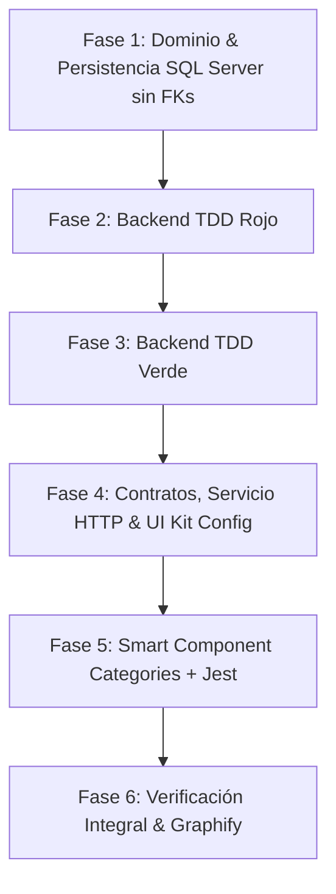

# Plan de Arquitectura e Implementación: US-001 - Catálogo de Categorías de Productos

**Issue Relacionado**: [US-001](https://github.com/walo/prueba_computrabajo/issues/1)  
**Especificación Técnica**: [US-001.spec.md](US-001.spec.md)  
**Estado**: Aprobado para `/feature-scaffold`  

---

## 1. Estrategia de Entrega por Fases Secuenciales

---

## 2. Fases de Ejecución

### Fase 1: Dominio y Persistencia (SQL Server 2022 sin FKs)
1. Crear entidad `Category` (`AggregateRoot<Guid>`), objetos de parámetro (`CategoryCreationData`, `CategoryUpdateData`, `CategoryUniquenessFilter`, `CategoryFilter`) y eventos de dominio en `Core/Domain` (1 tipo por archivo).
2. Declarar contratos `ICategoryRepository` e `ICategoryFinder` en `Application/Common/Interfaces/`.
3. Registrar `DbSet<Category>` en `AppDbContext`, configurar `CategoryConfiguration` (índices únicos en `Code` y `Name`, cero `.HasForeignKey()`), implementar `CategoryFinder` (EF Core `.AsNoTracking()`) y `CategoryRepository` (Dapper writes + validación segura de `dbo.Products`), y aplicar migración `AddCategoriesCatalog` en SQL Server Docker.

### Fase 2: Backend TDD Fase Roja (Failing Tests)
1. Redactar pruebas unitarias con xUnit, Moq y FluentAssertions en `tests/Tests.UnitTests/` para `CategoryTests`, validadores FluentValidation (`Create`, `Update`, `GetPaged`) y handlers (`Create`, `Update`, `Delete`, `GetPaged`, `GetById`).
2. Ejecutar `dotnet test src/backend/EnterpriseApp.sln --filter FullyQualifiedName~Categor` confirmando falla esperada en Red antes de implementar handlers.

### Fase 3: Backend Implementación Fase Verde (Passing Tests)
1. Implementar DTOs, Commands, Queries, Validators y Handlers en `Core/Application/Features/Categories/` cumpliendo estrictamente las 7 reglas de Clean Code de Redarbor (métodos `<= 25` líneas, `<= 1` anidación, paso de objetos, 1 tipo por archivo, sin líneas en blanco internas salvo antes de `return`, inglés 100%).
2. Implementar `CategoriesController` en `Presentation/Web.API/Controllers/` con `[HasPermission(Permissions.Categories.*)]`.
3. Añadir `CategoriesIntegrationTests` en `tests/Tests.IntegrationTests/` cubriendo flujo E2E HTTP y PBAC (`401`/`403`/`201`/`200`/`409`/`204`).
4. Ejecutar `dotnet test src/backend/EnterpriseApp.sln --filter FullyQualifiedName~Categor` hasta 100% Green.

### Fase 4: Frontend Contratos, Servicio y Registro Transversal
1. Registrar traducciones semánticas de errores `Category.*` en `src/frontend/src/app/core/config/error-messages.json`.
2. Montar `<ad-confirm-dialog />` globalmente en `src/frontend/src/app/app.html` si aún no está presente.
3. Crear modelos TypeScript en `src/frontend/src/app/features/categories/models/` y `CategoriesService` en `features/categories/services/categories.service.ts` recibiendo objetos tipados.
4. Registrar la ruta `/categories` con `permissionGuard` (`PERMISSIONS.CATEGORIES.READ`) en `FEATURES_ROUTES` y el ítem en `ShellComponent.navItems()`.

### Fase 5: Frontend Smart Component, `@accionadev/ui-kit` y Jest TDD
1. Escribir primero en Red `categories.service.spec.ts` y `categories-page.component.spec.ts` (Jest Zoneless).
2. Construir `CategoriesPageComponent` (`OnPush`, Signals) reutilizando exclusivamente `<ad-table>`, `<ad-modal>`, `<ad-input>`, `<ad-textarea>`, `<ad-switch>`, `<ad-select>`, `<ad-search-box>`, `<ad-badge>`, `<ad-button>`, `<ad-table-actions>` y `AdConfirmService`, protegiendo mutaciones con `*ngxPermissionsOnly`.
3. Ejecutar `npm run test:ci -- -t "Categor"` en `src/frontend/` hasta 100% Green.

### Fase 6: Verificación Integral y Grafo de Conocimiento
1. Ejecutar compilación limpia global `dotnet build src/backend/EnterpriseApp.sln --configuration Release` y `dotnet test src/backend/EnterpriseApp.sln --configuration Release` (incluyendo verificación contra SQL Server Docker).
2. Ejecutar `npm run test:ci` y `npm run build` en `src/frontend/`.
3. Actualizar el grafo AST con `graphify . --code-only --no-viz` / `graphify update .`.
