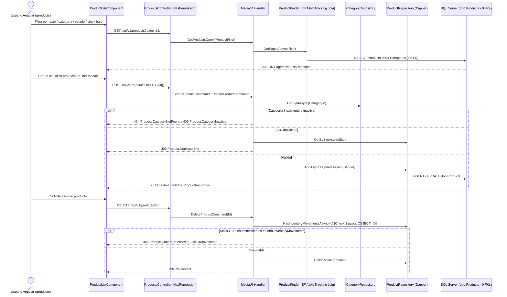

# Plan de Arquitectura e Implementación: US-002 - Catálogo de Productos

**Issue Relacionado**: [US-002 (#3)](https://github.com/walo/prueba_computrabajo/issues/3)  
**Especificación Técnica**: [US-002.spec.md](US-002.spec.md)  
**Estado**: Aprobado para `/feature-scaffold`  

---

## 1. Flujo de Interacción y Arquitectura

---

## 2. Fases de Ejecución en `/feature-scaffold`

### Fase 1: Dominio y Permisos PBAC (.NET 10)
1. Crear `ProductCreationData`, `ProductUpdateData` y `ProductFilter` en `src/backend/src/Core/Domain/ValueObjects/` (1 tipo por archivo).
2. Crear entidad `Product` (`AggregateRoot<Guid>`) en `src/backend/src/Core/Domain/Entities/Product.cs` con `Create`, `Update`, `AdjustStock`, `IsLowStock` y eventos `ProductCreatedDomainEvent`, `ProductUpdatedDomainEvent`, `ProductDeletedDomainEvent` en `Core/Domain/Events/`.
3. Verificar presencia de `Permissions.Products` (`Read`, `Create`, `Update`, `Delete`) en `Permissions.cs` e `InitialDataSeeder.cs`.

### Fase 2: Aplicación CQRS y TDD Rojo Backend
1. Declarar `IProductRepository` e `IProductFinder` en `Core/Application/Common/Interfaces/`.
2. Definir DTOs (`CreateProductRequest`, `UpdateProductRequest`, `ProductResponse`, `PagedProductsResponse`), Commands (`CreateProduct`, `UpdateProduct`, `DeleteProduct`), Queries (`GetProducts`, `GetProductById`) y Validators (`FluentValidation`) en `Core/Application/Features/Products/`.
3. **[TDD Red]** Escribir pruebas unitarias en `tests/Tests.UnitTests/` para `ProductTests`, `ProductValidatorsTests`, `CreateProductCommandHandlerTests`, `UpdateProductCommandHandlerTests`, `DeleteProductCommandHandlerTests` y `GetProductsQueryHandlerTests` confirmando falla esperada.
4. Implementar Handlers (inyectando `IProductRepository`, `ICategoryRepository`, `IProductFinder`, `IUnitOfWork`, nunca `AppDbContext`) cumpliendo las **7 Reglas de Clean Code Redarbor** (`<= 25` líneas por método, `<= 1` nivel de anidación, paso de objetos, 1 clase/record por archivo, cero líneas en blanco internas salvo antes de `return`, inglés 100%).

### Fase 3: Infraestructura EF Core + Dapper + Migración SQL Server sin FKs
1. Registrar `DbSet<Product>` en `AppDbContext.cs`.
2. Configurar `ProductConfiguration.cs` (`dbo.Products`, `.ValueGeneratedNever()`, `Price` `decimal(18,2)`, índice único `IX_Products_Sku`, índice no único `IX_Products_CategoryId`, **cero `.HasForeignKey()`**).
3. Implementar `ProductFinder.cs` (EF Core `.AsNoTracking()` + LINQ Join lógico con `Categories` + filtro `LowStockOnly`) y `ProductRepository.cs` (Dapper escrituras sobre `IDbConnectionFactory`, fallback InMemory y verificación 2 pasos de `dbo.InventoryMovements`). Registrar ambos en `Infrastructure/Persistence/DependencyInjection.cs`.
4. Generar migración `AddProductsCatalog` (`--configuration Release`), verificar 0 ocurrencias de `ForeignKey` en la migración y aplicarla sobre `redarbor-sqlserver`.

### Fase 4: Presentación `Web.API` y Pruebas de Integración
1. Implementar `ProductsController.cs` en `Presentation/Web.API/Controllers/` decorado con `[HasPermission(Permissions.Products.*)]`.
2. Escribir `ProductsIntegrationTests.cs` en `tests/Tests.IntegrationTests/Features/Products/` cubriendo PBAC (`401`/`403`), CRUD, join con Categoría activa/inactiva, `LowStockOnly`, conflicto por SKU duplicado y bloqueo de borrado cuando `Stock > 0`.
3. Verificar `dotnet test src/backend/EnterpriseApp.sln --configuration Release --filter FullyQualifiedName~Product` al 100% Green.
   - *Nota operativa:* Mientras el daemon de depuración (`Web.API` en puerto `5000`) esté activo en `Debug`, todas las compilaciones, pruebas y comandos `dotnet ef` deben ejecutarse con `--configuration Release` para evitar bloqueo de binarios (`MSB3027`), reiniciando el daemon únicamente al concluir el backend para exponer `/api/v1/products`.

### Fase 5: Frontend Angular 22+ Zoneless, `@accionadev/ui-kit` y Jest TDD
1. Agregar claves `Product.*` en `src/frontend/src/app/core/config/error-messages.json`.
2. Crear modelos en `features/products/models/` y `ProductsService` en `features/products/services/products.service.ts`.
3. **[TDD Red -> Green]** Escribir pruebas Jest `products.service.spec.ts` y `product-list.component.spec.ts` (cubriendo filtros combinados, indicador de stock bajo, modal Crear con `initialStock` vs Editar sin `initialStock`, carga de categorías activas en `<ad-select>`, confirmación de borrado y `*ngxPermissionsOnly`).
4. Implementar `ProductListComponent` (`features/products/pages/product-list.component.ts` + `.html`), registrar ruta `/products` en `FEATURES_ROUTES`, añadir entrada `'Productos'` (`icon: 'package'`) en `ShellComponent.navItems()` y habilitar navegación desde `DashboardComponent`.

### Fase 6: Verificación Integral y Graphify
1. Ejecutar `dotnet build src/backend/EnterpriseApp.sln --configuration Release`, `dotnet test src/backend/EnterpriseApp.sln --configuration Release`, `npm run test:ci` y `npm run build` en `src/frontend/`.
2. Ejecutar `graphify update .` para sincronizar el grafo de conocimiento AST.
