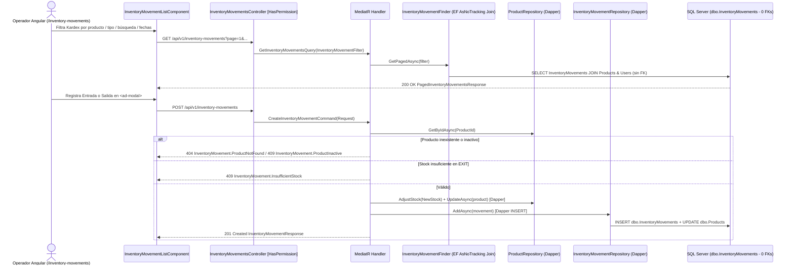

# Plan de Arquitectura e Implementación: US-003 - Movimientos de Inventario

**Issue Relacionado**: [US-003 (#5)](https://github.com/walo/prueba_computrabajo/issues/5)  
**Especificación Técnica**: [US-003.spec.md](US-003.spec.md)  
**Estado**: Aprobado para `/feature-scaffold`  

---

## 1. Flujo de Interacción y Arquitectura

---

## 2. Fases de Ejecución en `/feature-scaffold`

### Fase 1: Dominio y Permisos PBAC (.NET 10)
1. Crear `InventoryMovementTypes.cs` en `src/backend/src/Core/Domain/Constants/`, `InventoryMovementCreationData.cs` e `InventoryMovementFilter.cs` en `Core/Domain/ValueObjects/`, e `InventoryMovementCreatedDomainEvent.cs` en `Core/Domain/Events/` (1 tipo público por archivo).
2. **[TDD Red -> Green]** Escribir `InventoryMovementTests.cs` y crear entidad `InventoryMovement` (`AggregateRoot<Guid>`) en `Core/Domain/Entities/InventoryMovement.cs` con inmutabilidad tras creación, normalización de `Type`/`Reason`, cálculo automático de `NewStock` y rechazo de stock negativo (`InventoryMovement.InsufficientStock`), cumpliendo las **7 Reglas Clean Code Redarbor**.
3. Verificar permanencia de `Permissions.InventoryMovements.{Read, Create}` en `Permissions.cs` e `InitialDataSeeder.cs`.

### Fase 2: Aplicación CQRS y TDD Rojo Backend
1. Declarar `IInventoryMovementRepository` e `IInventoryMovementFinder` en `Core/Application/Common/Interfaces/`.
2. Definir DTOs (`CreateInventoryMovementRequest`, `InventoryMovementResponse`, `PagedInventoryMovementsResponse`), Command (`CreateInventoryMovement`), Queries (`GetInventoryMovements`, `GetInventoryMovementById`) y Validators (`FluentValidation` con guardas `When(x => x.Request is not null, ...)` y `When(x => x.Filter is not null, ...)`) en `Core/Application/Features/InventoryMovements/`.
3. **[TDD Red -> Green]** Escribir pruebas unitarias en `tests/Tests.UnitTests/Core/Application/Features/InventoryMovements/` para validadores y handlers (`CreateInventoryMovementCommandHandlerTests`, `GetInventoryMovementsQueryHandlerTests`, `GetInventoryMovementByIdQueryHandlerTests`, `InventoryMovementValidatorsTests`), e implementar handlers sin inyectar `AppDbContext`.

### Fase 3: Infraestructura EF Core + Dapper + Migración SQL Server sin FKs
1. Registrar `DbSet<InventoryMovement>` en `AppDbContext.cs`.
2. Configurar `InventoryMovementConfiguration.cs` (`dbo.InventoryMovements`, `.ValueGeneratedNever()`, índices `IX_InventoryMovements_ProductId` y `IX_InventoryMovements_CreatedAtUtc`, **cero `.HasForeignKey()`**).
3. Implementar `InventoryMovementFinder.cs` (EF Core `.AsNoTracking()` + `GroupJoin`/`DefaultIfEmpty` lógico hacia `Products` y `Users` + filtros `Search`/`ProductId`/`Type`/`FromDateUtc`/`ToDateUtc` + ordenamiento descendente por fecha) e `InventoryMovementRepository.cs` (escritura Dapper sobre `IDbConnectionFactory` + respaldo InMemory).
4. Actualizar `ProductRepository.HasInventoryMovementsAsync` en su rama no relacional para consultar `dbContext.InventoryMovements.AsNoTracking().AnyAsync(...)`.
5. Registrar repositorios y finders en `Infrastructure/Persistence/DependencyInjection.cs`, generar migración `AddInventoryMovements` (`--configuration Release`), verificar `0` ocurrencias de `ForeignKey` y aplicarla sobre `redarbor-sqlserver`.

### Fase 4: Presentación `Web.API` y Pruebas de Integración
1. Implementar `InventoryMovementsController.cs` en `Presentation/Web.API/Controllers/` decorado con `[HasPermission(Permissions.InventoryMovements.Read)]` y `[HasPermission(Permissions.InventoryMovements.Create)]`.
2. **[TDD Red -> Green]** Escribir `InventoryMovementsIntegrationTests.cs` en `tests/Tests.IntegrationTests/Features/InventoryMovements/` cubriendo PBAC (`401`/`403` para `USER` al intentar `POST`), creación `ENTRY` + incremento de `Product.Stock`, creación `EXIT` + descuento y activación de stock bajo, rechazo `EXIT` con stock insuficiente (`409`), rechazo sobre producto inactivo (`409`), bloqueo de eliminación en `DELETE /api/v1/products/{id}` tras existir movimientos (`409 Product.CannotDeleteWithStockOrMovements`), y consulta filtrada por producto/tipo/fechas.
   - *Nota operativa:* Mientras el daemon `Web.API` esté corriendo en `Debug` en puerto `5000`, usar `--configuration Release` en compilaciones, tests y migraciones EF, reiniciando el daemon al finalizar el backend.

### Fase 5: Frontend Angular 22+ Zoneless, `@accionadev/ui-kit` y Jest TDD
1. Agregar claves `InventoryMovement.*` en `src/frontend/src/app/core/config/error-messages.json`.
2. Crear modelos en `features/inventory-movements/models/` y `InventoryMovementsService` + `inventory-movements.service.spec.ts` (archivo spec dedicado) en `features/inventory-movements/services/`.
3. **[TDD Red -> Green]** Escribir `inventory-movement-list.component.spec.ts` en Red y luego implementar `InventoryMovementListComponent` (`features/inventory-movements/pages/inventory-movement-list.component.ts` + `.html`) usando exclusivamente `@accionadev/ui-kit`, vista previa reactiva de stock resultante y `*ngxPermissionsOnly`.
4. Registrar ruta `/inventory-movements` en `FEATURES_ROUTES`, actualizar `ShellComponent` (`pageTitle` y ítem `'Movimientos'` con `icon: 'layers'`) y envolver tarjeta `"Movimientos"` de `DashboardComponent` con `<a routerLink="/inventory-movements">`.

### Fase 6: Verificación Integral y Graphify
1. Ejecutar `dotnet build src/backend/EnterpriseApp.sln --configuration Release`, `dotnet test src/backend/EnterpriseApp.sln --configuration Release`, `npm run test:ci` y `npm run build` en `src/frontend/`.
2. Ejecutar `graphify update .` para sincronizar el grafo de conocimiento AST.
