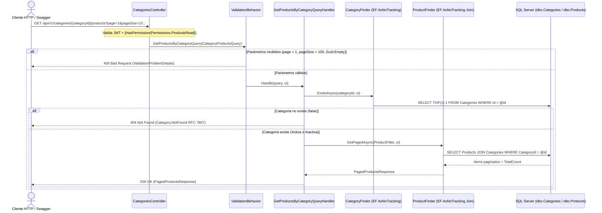

# Plan de Arquitectura e Implementación: US-004 - Consulta de Productos por Categoría

**Issue Relacionado**: [US-004 (#8)](https://github.com/walo/prueba_computrabajo/issues/8)  
**Especificación Técnica**: [US-004.spec.md](US-004.spec.md)  
**Estado**: Aprobado para `/feature-scaffold`  

---

## 1. Flujo de Interacción y Arquitectura

---

## 2. Fases de Ejecución en `/feature-scaffold`

### Fase 1: Dominio y Contratos de Lectura (.NET 10)
1. Crear `CategoryProductsFilter.cs` y `CategoryProductsQuery.cs` en `src/backend/src/Core/Domain/ValueObjects/` (`1` record público por archivo, Reglas 6 y 7 de Redarbor).
2. Verificar que `Permissions.ProductsRead` existe en `src/backend/src/Core/Domain/Constants/Permissions.cs` e `InitialDataSeeder.cs`.
3. Extender `ICategoryFinder.cs` en `src/backend/src/Core/Application/Common/Interfaces/` con `Task<bool> ExistsAsync(Guid id, CancellationToken ct = default);`.
4. Crear `GetProductsByCategoryQuery.cs` en `src/backend/src/Core/Application/Features/Products/Queries/GetProductsByCategory/`.

### Fase 2: Aplicación CQRS — TDD Rojo Backend
1. **[TDD Red]** Crear `GetProductsByCategoryQueryValidatorTests.cs` en `src/backend/tests/Tests.UnitTests/Core/Application/Features/Products/` cubriendo `Request` nulo, `Filter` nulo, `CategoryId` vacío, `Page < 1`, `PageSize` fuera de `1..100`, `Search` mayor a `150` caracteres y combinación válida.
2. **[TDD Red]** Crear `GetProductsByCategoryQueryHandlerTests.cs` en `src/backend/tests/Tests.UnitTests/Core/Application/Features/Products/` cubriendo categoría inexistente (`Category.NotFound` sin invocar `IProductFinder.GetPagedAsync`), categoría existente con filtros propagados (`CategoryId`, `Search`, `IsActive`, `LowStockOnly`, `Page`, `PageSize`) y categoría válida sin productos (`Items` vacío, `TotalCount = 0`).
3. Verificar compilación/ejecución en estado **Rojo** antes de implementar las clases productivas del slice.

### Fase 3: Aplicación CQRS e Infraestructura — TDD Verde Backend
1. Implementar `GetProductsByCategoryQueryValidator.cs` en `src/backend/src/Core/Application/Features/Products/Queries/GetProductsByCategory/` con helpers planos (`ConfigureRequestRules`, `ConfigureFilterRules`) respetando `<= 25` líneas por método y `<= 1` nivel de anidamiento.
2. Implementar `GetProductsByCategoryQueryHandler.cs` inyectando exclusivamente `ICategoryFinder` e `IProductFinder` (cero `AppDbContext`, cero `IRepository`), con helper privado `BuildProductFilter`.
3. Implementar `ExistsAsync(Guid id, CancellationToken ct = default)` en `src/backend/src/Infrastructure/Persistence/Finders/CategoryFinder.cs` usando `dbContext.Categories.AsNoTracking().AnyAsync(category => category.Id == id, ct)` (sin migración EF Core ni `FOREIGN KEY`).
4. **[TDD Green]** Ejecutar `dotnet test src/backend/EnterpriseApp.sln --configuration Release --filter FullyQualifiedName~GetProductsByCategory` y confirmar 100% Verde.

### Fase 4: Presentación `Web.API` y Pruebas de Integración TDD
1. Agregar `GetProductsByCategory(Guid categoryId, [FromQuery] CategoryProductsFilter filter, CancellationToken ct)` en `src/backend/src/Presentation/Web.API/Controllers/CategoriesController.cs` con `[HttpGet("{categoryId:guid}/products")]` y `[HasPermission(Permissions.ProductsRead)]`.
2. Agregar ejemplo de llamada en `src/backend/src/Presentation/Web.API/Web.API.http`.
3. **[TDD Red -> Green]** Crear `CategoryProductsIntegrationTests.cs` en `src/backend/tests/Tests.IntegrationTests/Features/Categories/` verificando:
   - `401 Unauthorized` sin token Bearer.
   - `403 Forbidden` para usuario autenticado sin `Products.Read`.
   - `200 OK` para rol `ADMIN` y rol de solo lectura `USER` con filtros (`search`, `isActive`, `lowStockOnly`, `page`, `pageSize`).
   - `200 OK` para categoría en estado *Inactivo* con productos históricos.
   - `200 OK` con lista vacía y `totalCount = 0` para categoría existente sin productos.
   - `404 NotFound` (`Category.NotFound`) cuando el `categoryId` no existe.
   - `400 BadRequest` (`ValidationProblemDetails`) ante paginación inválida (`page=0`, `pageSize=101`).
4. Ejecutar `dotnet test src/backend/EnterpriseApp.sln --configuration Release --filter FullyQualifiedName~CategoryProducts` y confirmar 100% Verde.

### Fase 5: Frontend Angular (Fuera de Alcance)
- `0` cambios en `src/frontend/` conforme a la entrevista aprobada (`US-004-interview.md`).

### Fase 6: Verificación Integral, Auditoría Clean Code y Graphify
1. Ejecutar compilación y suite global de Backend:
   - `dotnet build src/backend/EnterpriseApp.sln --configuration Release`
   - `dotnet test src/backend/EnterpriseApp.sln --configuration Release`
2. Auditar todos los archivos creados o modificados contra las **7 Reglas de Clean Code Redarbor** (`.agents/rules/redarbor-clean-code.md`).
3. Ejecutar `graphify update .` para mantener sincronizado el grafo AST en `graphify-out/`.
